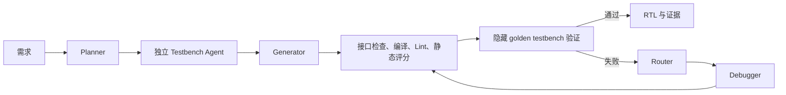

# VerilogAgent：面向 RTL 生成与验证的多 Agent 系统

VerilogAgent 将硬件需求整理为规格，生成 Verilog/SystemVerilog RTL，并在受限 Docker 容器中调用 Icarus Verilog、Verilator 和 Yosys 检查候选实现。验证失败后，系统按错误类型触发受预算约束的修复。项目保留静态评分和验证证据驱动的 Memory，目标是提高 RTL 生成的正确率与可追溯性。

> 当前状态：旧 Orchestrator 继续提供基线；M1 新增 LangGraph 入口、前置独立 Testbench Agent、显式授权的只读参考文件工具和可选 LangSmith 追踪。新入口已通过离线回归，但尚未完成 Human v2 成对重测。外部文档 RAG、VCD 摘要和 Yosys 综合门禁仍属 M2。

## 快速导航

| 想了解 | 文档 |
|---|---|
| 目标与当前边界 | [01 项目概览](docs/01-overview.md) |
| 安装、离线演示与测试 | [02 快速开始](docs/02-getting-started.md) |
| 新旧入口与状态边界 | [03 架构](docs/03-architecture.md) |
| Agent、工具权限和 Docker EDA | [04 Agent 与工具](docs/04-agents-and-tools.md) |
| 历史 Memory 与外部文档 RAG | [05 Memory 与 RAG](docs/05-memory-and-rag.md) |
| Human v2、对照与消融口径 | [06 评测](docs/06-evaluation.md) |
| M1/M2/M3 实施顺序 | [07 路线图](docs/07-roadmap.md) |
| 按主题阅读 | [文档目录](docs/README.md) |

## 当前执行路径



当前默认先生成一个独立候选；硬门禁失败或静态质量分低于 75 时按预算生成下一个候选。静态合格后进入功能验证，功能失败优先修复；无进展或修复预算耗尽时再尝试新候选。候选上限默认两个，修复预算由入口参数决定。所有 EDA 命令由确定性服务通过一次性 Docker 容器执行，模型不直接获得通用 shell 权限。

LangGraph 入口复用现有 Agent、评分、EDA、Router、Memory 和 SQLite 审计；旧入口不下线。生成 TB 只提供辅助反馈，最终通过以隐藏 golden TB 为准；没有独立 oracle 时报告待人工验收。详见[架构](docs/03-architecture.md)与[评测](docs/06-evaluation.md)。

## 仓库地图

```text
verilog_agent/
  agents/           Planner、Testbench、Generator、Debugger
  orchestration/    旧 Orchestrator、新 LangGraph 与 SQLite 审计
  services/         候选评估、Verifier、Router、Docker EDA 网关
  memory/           已验证设计、错误和修复策略的 SQLite 检索
  providers/        模型提供方适配
  benchmarks/       Human v2、RTLLM 评测入口
  web/              本地 Web 工作台代码
tool_wrapper.py      容器内 EDA 操作与统一 ToolResult
Dockerfile           非 root EDA 沙盒镜像
config/              可提交的默认配置
tests/               单元、集成与固定回归夹具
docs/                7 篇核心手册与 reference/ 深入材料
experiments/reports/ 历史实验记录
data/benchmarks/     本地基准数据；不提交仓库
runs/                生成的任务证据；不提交仓库
```

RS 专项代码、测试与报告保留在本地，但不纳入 GitHub 项目仓库。

## 本地快速开始

在 Windows PowerShell 中，从仓库根目录运行：

```powershell
python -m venv .venv
.\.venv\Scripts\python.exe -m pip install -e ".[dev,graph]"
docker build -t verilog-agent-sandbox .
.\.venv\Scripts\python.exe -m verilog_agent.benchmarks.single_case_demo --offline-example
.\.venv\Scripts\python.exe -m verilog_agent.benchmarks.single_case_demo --offline-example --orchestrator langgraph --static-evaluation
.\.venv\Scripts\python.exe -m pytest -q
```

离线演示和单元测试不调用真实模型；带 `--static-evaluation` 的新入口需要 Docker。Docker 集成测试另用 `pytest --run-integration -m integration`。真实模型需要本地密钥与兼容的 Responses API；详细步骤见[快速开始](docs/02-getting-started.md)。

## 评测与安全边界

- Human v2 的 `ref.sv` 和 golden testbench 只供 Verifier 内部使用，不进入 Planner、Generator、Debugger、可检索 Memory 或 LangSmith 原始追踪。
- 生成 TB 用于开发反馈；有 golden TB 时，最终功能通过以独立 golden TB 为准。没有独立 oracle 的真实用户任务应单独标明验证置信度。
- Icarus、Verilator、Yosys 只在 Docker 沙盒内运行；RTL/TB 与审计证据可持久化在宿主机，作为只读输入挂入容器。
- 静态评分、综合统计不等于功能正确，也不等于目标芯片的真实 PPA。
- 历史报告使用其各自记录的模型、配置和协议。M1 改造完成后重新运行新旧入口对照，不把历史百分比当成新流程的成绩。

仓库采用 Git 管理代码与文档；密钥、基准原始数据和 `runs/` 产物不得提交。项目仍在研究与工程迭代阶段，具体限制见[项目概览](docs/01-overview.md)。
