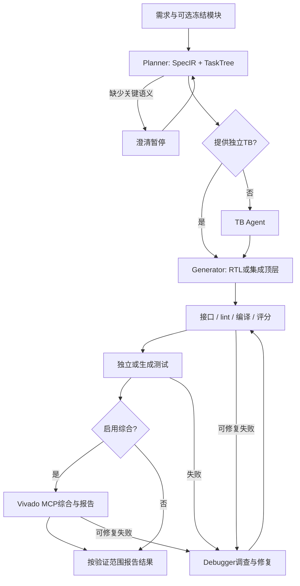

# 03 · 架构与运行边界

控制台使用LangGraph；旧Orchestrator仍供部分CLI、Web和对照使用。二者复用WorkflowOperations、
WorkflowPolicy、静态检查、Verifier和Memory，不是两套独立RTL算法。

程序控制路径、工具白名单、合同、预算和完成条件。Planner/Generator/Debugger不能自行宣布正确。
生成测试通过不等于独立验证。控制台有独立TB时跳过TB Agent，不同时展示两条验收路径。

集成入口只生成新顶层，依赖源码和合同被冻结并校验hash；支持已有集成候选的传递依赖。
静态、仿真和综合使用相同源码集合。修复不能改子模块；需先单独验证新子模块，再发起新集成。

修复链优先耗用剩余修复预算，修复引入编译错误也继续诊断；耗尽后失败，不再独立重生成。
基础设施/许可证/模型错误独立终止；不能计作RTL功能不正确。续跑创建新证据分支，预算须累计报告。

SQLite审计、LangGraph checkpoint和长期Memory分别存储。图支持澄清、持久恢复和节点边界取消；
外部请求完成与回执写入之间仍存在崩溃窗口，不保证付费请求恰好执行一次。
Web不提供认证多用户调度，公开部署不属于本版本能力。
