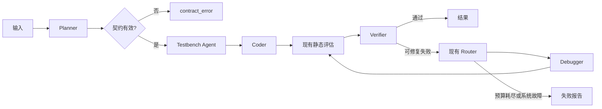

# 03 · 架构与状态边界

## 当前闭环

`Orchestrator` 依靠显式 `TaskStage` 流转，调用 Planner、Generator、静态评估、Verifier、Router 与 Debugger。SQLite 持久化事件和任务检查点。Docker EDA 网关隔离编译、仿真和综合。具体阶段以[代码](../verilog_agent/orchestration/orchestrator.py)和[状态机](../verilog_agent/orchestration/state_machine.py)为准。

## M1 新入口设计（尚未实现）

图节点调用已有 Agent 与服务。EDA 操作仍由确定性服务决定，模型没有任意 `run_shell`。Testbench Agent 在 Coder 前运行，Coder 只得到契约和测试目标摘要；生成 TB 全文与 golden TB 对生成/调试 Agent 隔离。

M1 Graph State 计划保留：`task_id`、`user_raw_spec`、冻结的 `contract`、`contract_errors`、候选引用/分数、生成 TB 引用与 PASS、golden PASS、最小失败摘要、`retry_count/max_retry`、Memory 检索摘要、`experiment_tags`、`task_stage/final_status`。`wave_summary`、`synth_log`、`doc_retrieval_chunks` 在 M1 留空。

用户提供的配置稿提出把 `golden_tb_files` 和完整文件内容放入共享 State。实施时应改为受权限控制的文件引用、哈希和摘要：隐藏 golden TB 只由 Verifier 内部解析，避免被共享 State、checkpoint 或追踪暴露；大文件也不应随每次 checkpoint 复制。

LangGraph checkpoint 用独立数据库或文件管理临时断点，现有审计 SQLite 继续保存永久证据。新旧入口使用两个唯一 `task_id`，用 `experiment_pair_id` 关联；不能让两个运行写同一任务检查点。每个任务分别记录 `orchestrator=langgraph` / `orchestrator=legacy_orchestrator`。

任务级 `coding_style_constraint` 是单值枚举 `strict_sv | legacy_verilog`。`strict_sv` 面向新项目，可禁止 DUT `initial`；`legacy_verilog` 面向基准原生语法。不能对全部 VerilogEval 题目套用严格 SV 门禁。
