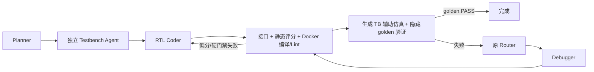

# 03 · 架构与状态边界

## 两个入口

旧入口 [Orchestrator](../verilog_agent/orchestration/orchestrator.py) 仍按 `TaskStage` 顺序执行，维持历史基线。新入口 [LangGraphOrchestrator](../verilog_agent/orchestration/graph.py) 只替换调度：图节点调用同一套 Planner、Generator、Debugger、静态评分、Verifier、Router 和 Memory 组件。两者的事件与任务证据写入同一类 SQLite 审计库，但任务 ID 必须不同。

生成 TB 先于 RTL，Coder 只见契约和测试目标摘要，不见 TB 源码。Verifier 可用生成 TB 做辅助仿真；结果不改变 golden 判定，也不被写为基准通过。没有 golden 时停在待人工验收。静态低分优先按旧策略生成独立候选，功能失败优先修复；预算与安全失败由现有 Router 处理。

## 数据与恢复边界

Graph State 仅存可序列化任务上下文、阶段和少量结果标志。候选源码、生成 TB 和工具结果存任务产物目录；隐藏 golden TB **不在 Graph State 或模型输入中**，仅由 Verifier 私有解析。Graph 的 `InMemorySaver` 只支持同进程临时断点；跨进程恢复仍依赖原有 SQLite 审计检查点，尚未实现图级跨进程恢复。两种存储不混用。

任务契约中的 `coding_style_constraint` 为 `strict_sv` 或 `legacy_verilog`：新项目默认前者，Human v2 默认后者。当前严格模式通过提示词和静态门禁禁止 DUT `initial`；其它综合风格仍需工具和人工审查，不宣称已证明可综合性。M2 的文档 RAG、VCD 摘要和 Yosys 综合门禁不进入 M1 主路径。
