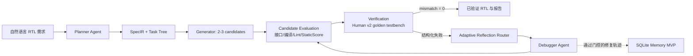
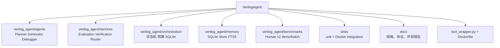
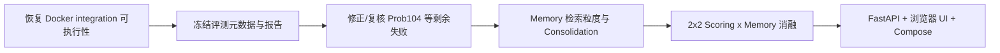

# VerilogAgent 当前工作总结与后续计划

> 更新日期：2026-09-07
>
> 软件版本：`0.2.4`
> 工作分支：`agent/human-v2-batch-eval`（对应远端同名分支；`main` 已合并至 PR #21）

## 1. 项目现在处于什么阶段

VerilogAgent 已从“Planner/Generator 原型”进入**可执行的 RTL 生成、验证和受控修复闭环**阶段：真实
Planner、Generator、Candidate Evaluation、golden-testbench Verification、Reflection Router 和
Debugger 都已接入同一 Orchestrator。当前还不是最终可交付产品：浏览器聊天界面、API、Docker Compose、
完整的分层 Memory/后台 Consolidation，以及可归因的正式消融实验尚未完成。



边界不变：只有 Planner、Generator、Debugger 是 LLM Agent；评分、验证、路由、预算、状态机和
Memory 写入判定均是可审计的确定性代码。`ref.sv` 和 golden testbench 只由 Verification 使用，
不进入 Planner、Generator、Debugger 或可检索 Memory。

## 2. 已完成

| 里程碑 | 状态 | 已有证据 |
|---|---|---|
| Phase 0：仓库治理与自动化基线 | 完成 | Git/GitHub 私有仓库、CI、Issue/PR 模板、`v0.0.1-prototype` |
| Phase 1：安全 EDA 沙箱与统一工具接口 | 完成 | Docker + Icarus/Verilator/Yosys；`tool_wrapper.py` 的 lint/compile/simulate/eval_quality/benchmark |
| Phase 2：领域模型、状态机、Fake 闭环 | 完成 | SQLite 事件/检查点、预算、取消、恢复和离线测试 |
| Phase 2：真实 Planner / Generator | 完成第一版 | 严格 `SpecIR`/Task Tree、2-3 候选、接口校验、哈希去重 |
| Phase 2：Candidate Evaluation | 完成第一版 | 接口门禁、Docker 编译/Lint、StaticScore、排序与候选回退 |
| Phase 2：Verification / Router / Debugger | 完成第一版 | golden testbench、结构化最小反馈、分类路由、child candidate、重评估、回滚和修复预算 |
| Phase 3：Memory MVP | 已启动并可调用 | `RepairAttempt`、SQLite `MemoryItem`、FTS5/BM25 检索、`off/read_only/read_write`、同题隔离、负迁移 quarantine |
| Human v2 工程评测 | 已有全量基线与定向复测 | 156 题预检、一次全量模型运行、9 题定向复测、单题复核；详情见下节 |

当前代码结构：



## 3. 已有评测证据与正确口径

| 记录 | 结果 | 能说明什么 / 不能说明什么 |
|---|---:|---|
| Human v2 官方参考预检 | 154/156 PASS；2 项 Icarus cast 不兼容 | 数据集和验证管线可用；两项是工具异常，不是 Agent RTL 失败 |
| 第一次顺序全量模型运行 | 145/154 = 94.16%（全部 156 题口径 92.95%） | 当前闭环的首个全量工程基线 |
| 仅对首轮 9 个失败题定向复测 | 7/9 = 77.78% | 不是第二次 156 题实验 |
| 将定向复测回填首轮 | 152/154 = 98.70%（156 题口径 97.44%） | 修改后系统的有效合并结果，不能归因给单一模块或 Memory |
| `Prob078_dualedge` 后续单题复核 | 新生成 `cand_02` 通过；若作为补充回填为 153/154 = 99.35% | 新候选匹配了 golden 的 delta-cycle 调度；不是稳定复现，也不是 Debugger/Memory 的效果 |

定向复测在 `read_write` 下记录了 13 条 `RepairAttempt`；5 条验证成功的修复形成
`REPAIR_STRATEGY` Memory，其中 4 条因负迁移被 `QUARANTINED`，1 条仍为 `ACTIVE`。这证明
Memory MVP 的写入、检索、反馈和隔离链路可运行；**不证明** Memory 导致通过率提升，因为候选数、
修复提示、接口处理和模型调用也同时变化，且没有固定随机种子。

完整证据和失败原因在
[`HUMAN_V2_TWO_RUN_EVALUATION_REPORT_ZH.md`](HUMAN_V2_TWO_RUN_EVALUATION_REPORT_ZH.md)。

## 4. 当前验证状态

本次状态更新在当前工作区运行：

```text
.\.venv\Scripts\python.exe -m pytest -q
103 passed, 12 skipped
```

12 项 skipped 是明确标记为 `integration` 的 Docker EDA 测试，默认不启动 Docker。尝试显式运行
`pytest -q --run-integration -m integration` 时，当前 Codex 终端找不到 Docker CLI，12 项均在测试
初始化阶段失败，尚未进入 RTL 或 EDA 断言。这是**当前终端环境发现问题**，不是“Docker 测试已通过”
或“RTL 测试失败”的结论。用户本机 Docker 可用时，设置 `DOCKER_BIN` 为 `docker.exe` 的绝对路径后重跑：

```powershell
$env:DOCKER_BIN = "C:\Program Files\Docker\Docker\resources\bin\docker.exe"
.\.venv\Scripts\python.exe -m pytest -q --run-integration -m integration
```

若该路径不存在，请先在你的 PowerShell 中执行 `Get-Command docker`，把返回的 `Source` 作为
`DOCKER_BIN`；不要把当前失败的 12 项写进 Human v2 成功率。

## 5. 正在进行但尚未完成

1. **Memory 从 MVP 走向分层系统。** 当前没有五类完整 schema、异步 Consolidation Worker、跨任务
   重复正迁移提升和独立 A/B 证明；“事件与检查点”也不能替代长期 Memory。
2. **评测协议冻结。** 需要记录 prompt 版本/hash、temperature/top-p、token、API 成本、墙钟时间、
   Docker image digest、Icarus 版本、seed/采样参数，再完整顺序运行一次 156 题。
3. **失败案例深挖。** `Prob104_mt2015_muxdff` 仍是 1/199 mismatch；应补充首个 mismatch 时刻和
   时序分类，而不是盲目提高相同 Debugger 提示下的修复次数。
4. **产品化。** FastAPI/SSE、浏览器聊天页、候选/诊断可视化、下载和 Docker Compose 都未开始。

## 6. 推荐的下一顺序



这样做先保证“通过率、失败原因和 Memory 声明”可审计，再把稳定闭环包装成任何人都能一键启动的产品。
