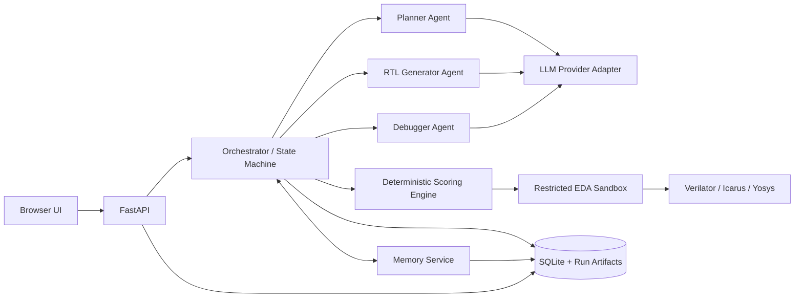

# VerilogAgent 项目计划书与需求规格说明书

> 文档版本：v1.0  
> 计划周期：12 周（单人全职基线，可按实际投入等比例延长）  
> 项目形态：本地部署、浏览器访问、Docker 隔离执行的轻量化多 Agent RTL 生成与修复系统

## 1. 项目摘要

VerilogAgent 面向 Verilog/SystemVerilog 设计任务。用户在浏览器中输入自然语言规格，系统生成接口契约和实现计划，产生若干 RTL 候选，在受限 EDA 沙箱内进行静态检查、编译和仿真，再依据可解释评分选择或修复候选，最终输出 RTL、测试平台、验证报告和完整运行记录。

项目不追求堆叠大量 Agent，而采用“少量专业 Agent + 确定性工具 + 显式状态机”的路线。首版只设置 Planner、RTL Generator、Debugger 三个 LLM 角色，评估、路由、停止条件、记忆写入均由普通程序控制。这样可以降低模型调用次数、延迟、费用和不可预测性。

项目的两个核心创新点为：

1. **评分驱动的搜索与修复**：用确定性 EDA 结果和结构化质量指标为候选打分，决定保留、淘汰、修复、回滚和停止，而不是让 LLM 自己判断“是否正确”。
2. **面向 RTL 调试的分层记忆**：把任务事实、失败轨迹、修复经验和高质量设计模式分层保存，并用质量门控控制写入和检索，避免把错误经验长期传播。

## 2. 背景、现状与问题

### 2.1 原计划的可继承部分

原计划已经形成最小闭环：读取配置、调用兼容 OpenAI 协议的模型、提取 RTL、调用 Icarus Verilog 编译、把错误日志反馈给模型，并在有限轮次内修复。该闭环应保留，作为新系统最底层的可运行纵向切片。

### 2.2 当前仓库状态

当前 `VerilogAgent` 已具备 Dockerfile、Icarus Verilog 编译/仿真、Verilator lint、结构化错误解析、样例 RTL 与 testbench；尚未实现 Agent 编排、任务状态、评分、记忆、API、浏览器 UI、并发隔离及完整测试。

### 2.3 当前主要缺口

- 没有明确的需求到接口契约转换，生成结果容易偏离端口、时序和复位要求。
- 只判断编译是否通过，无法区分“能编译”和“功能正确、质量良好”。
- 没有候选比较、修复收益判断、停滞检测和可靠停止条件。
- 每次任务从零开始，无法复用已验证的修复经验，也没有防止错误记忆污染的机制。
- 工具执行缺少超时、唯一工作区、资源限制、非 root 用户和安全路径约束。
- 没有 Git 里程碑、分支、提交、标签、CI 和可回滚发布规范。
- 没有本地 API、浏览器界面、任务历史和结果下载。

## 3. 项目目标与边界

### 3.1 总目标

在普通开发机上通过 Docker Compose 一键启动一个本地 Web 应用，使用户能够提交 RTL 需求、观察多 Agent 执行过程、获得经过自动验证和评分的结果，并让系统从高质量历史任务中积累可审计的工程记忆。

### 3.2 可量化目标

- 单个简单任务使用不超过 3 个 LLM 角色；默认最多生成 3 个候选、修复 3 轮。
- 所有工具调用有超时、资源上限、独立工作目录和结构化结果。
- 对每个候选输出评分分解、失败分类、选择理由和证据文件。
- 相同输入、相同模型配置、相同随机种子下，工具评估与排序可复现。
- API 不因单次 EDA 超时或错误退出而崩溃；并发任务互不覆盖文件。
- MVP 可通过浏览器完成提交、查看进度、查看/下载结果的全流程。
- 记忆关闭时系统仍可完整运行；开启后能度量成功率、修复轮次或 token 成本的变化。

### 3.3 MVP 范围

- 组合逻辑、计数器、移位寄存器、有限状态机和常见小型 RTL 模块。
- 单模块为主，支持用户提供或系统生成 testbench。
- 支持 OpenAI-compatible 云模型接口；模型适配层为后续 Ollama/local model 预留接口。
- 支持 Verilator lint、Icarus compile/simulate；Yosys elaboration/synthesis 作为推荐扩展。
- 本地 SQLite + 文件系统存储，不引入 Redis、Kafka、Kubernetes 或独立向量数据库。

### 3.4 非目标

- 首版不做完整 SoC、多时钟域签核、形式验证闭环、布局布线或商用 EDA 集成。
- 首版不训练或微调基础模型。
- 首版不允许 Agent 自由执行 Shell；Agent 只能调用白名单工具。
- 首版不实现通用自治 Agent 平台，也不复制 MAGE/VerilogCoder 的完整框架。

## 4. 用户角色与典型场景

### 4.1 用户角色

- RTL 学习者：输入需求，观察计划、代码和错误修复过程。
- RTL 工程师：快速生成初稿、验证接口和行为、下载工程产物。
- 研究人员：比较评分策略、记忆策略、模型和提示词的实验效果。
- 系统维护者：管理模型配置、资源上限、基准集和版本发布。

### 4.2 核心用户故事

- 作为用户，我能输入自然语言需求及可选端口约束，获得结构化规格供确认。
- 作为用户，我能看到每个候选的 lint、编译、仿真和综合评分，而非只看到最终代码。
- 作为用户，我能知道系统为何选择某个候选、为何继续修复或停止。
- 作为用户，我能下载 RTL、testbench、日志、波形、评分报告和任务清单。
- 作为研究人员，我能关闭记忆或更换评分权重，运行同一基准并比较结果。
- 作为维护者，我能从 Git 标签重建任一里程碑版本，并用 CI 验证回归。

## 5. 整体架构



### 5.1 架构原则

- **LLM 负责提出方案，工具负责裁决事实**：语法、接口、仿真和综合结果不交给 LLM 猜测。
- **编排器是唯一决策中心**：Agent 不直接相互聊天；它们通过类型化输入/输出和共享任务状态协作。
- **失败先分类再修复**：接口错误、语法错误、lint、编译、仿真、超时分别走不同提示和修复策略。
- **所有副作用可追踪**：每次模型调用、工具调用、分数变化、记忆命中与文件版本均写入事件日志。
- **轻量优先**：单进程 API、SQLite、文件系统、Docker worker；达到真实瓶颈后才引入队列或分布式组件。

### 5.2 三个 Agent 的职责

| Agent | 输入 | 输出 | 不负责 |
|---|---|---|---|
| Planner | 用户需求、约束、相关记忆 | `SpecIR`、端口契约、行为表、实现步骤、验证点 | 生成最终 RTL、判断测试通过 |
| RTL Generator | 已确认的 `SpecIR`、计划、候选策略 | 一个或多个 RTL 候选及设计假设 | 执行任意命令、宣布任务成功 |
| Debugger | 当前代码、结构化错误、波形摘要、历史修改 | 最小补丁或新候选、故障解释 | 无限重写、修改规格和测试 oracle |

### 5.3 编排状态机

```text
CREATED -> SPECIFIED -> PLANNED -> GENERATED -> EVALUATED
                                         ^          |
                                         |          +-- PASS -> COMPLETED
                                         |          +-- FAIL -> CLASSIFIED -> REPAIRING
                                         |                              |
                                         +------------------------------+

任意阶段：超时/取消 -> CANCELLED；不可恢复错误 -> FAILED
```

编排器采用显式预算：最大候选数、最大修复轮数、最大 token、最大墙钟时间。若连续两轮总分提升小于阈值、错误签名重复或预算耗尽，则停止自动修复并返回最优候选和失败说明。

## 6. 创新点一：评分驱动的候选选择与修复

### 6.1 为什么评分是核心

二元的“编译通过/失败”无法表达质量梯度。评分系统把验证证据转化为可解释的优化信号，使系统能够比较候选、选择最值得修复的分支、识别修复是否进步，并支持稳定的实验评价。

### 6.2 硬门槛与软评分

先执行硬门槛，避免高风格分掩盖功能错误：

1. 文件与端口接口合规；
2. 无工具超时或沙箱违规；
3. Verilator 无致命错误；
4. Icarus 编译成功；
5. testbench 断言全部通过。

候选只有通过前一门槛才进入后一阶段。总分用于同层候选排序：

```text
Score = 0.15 * Interface
      + 0.15 * Lint
      + 0.15 * Compile
      + 0.35 * Simulation
      + 0.10 * Synthesis
      + 0.05 * Simplicity
      + 0.05 * Robustness
      - Penalties
```

各项归一化为 0-100。MVP 中没有 Yosys 时，其权重按配置重新归一化，不将“未执行”误判为失败。

### 6.3 评分项定义

- **Interface**：模块名、端口名、方向、位宽、时钟/复位极性是否符合 `SpecIR`。
- **Lint**：错误数必须为 0；按 warning 严重度扣分，重点关注 latch、多驱动、位宽、未使用信号。
- **Compile**：成功为满分；失败为 0，并记录错误数量、位置和签名。
- **Simulation**：断言通过率、测试用例覆盖率、是否出现 X/Z、是否超时；功能错误权重最高。
- **Synthesis**：Yosys elaboration 是否成功，是否存在组合环、未解析模块及异常资源规模。
- **Simplicity**：代码规模、嵌套复杂度和无效逻辑；只做小权重 tie-breaker，防止为“短”牺牲正确性。
- **Robustness**：附加随机/边界测试的通过率，或不同随机种子下的一致性。
- **Penalties**：修改规格、绕过断言、删除测试、不可综合结构、超预算、重复错误等直接扣分或判零。

### 6.4 评分数据结构

```json
{
  "candidate_id": "cand_002",
  "gate": "SIMULATION_FAIL",
  "total": 62.5,
  "components": {
    "interface": 100,
    "lint": 85,
    "compile": 100,
    "simulation": 25,
    "synthesis": null,
    "simplicity": 90,
    "robustness": 0
  },
  "penalties": [{"code": "ASSERT_FAIL", "value": 10}],
  "evidence": ["lint.json", "compile.json", "simulation.json"]
}
```

### 6.5 评分如何控制流程

- 初次生成 `K=3` 个低温度差异化候选，全部通过快速门槛。
- 使用词典序先比较硬门槛阶段，再比较总分，避免不正确候选因软指标胜出。
- 选择最高分且最接近下一门槛的候选进入 Debugger。
- 保存每轮 `delta_score`；只接受分数提升或通过更高门槛的修复，否则回滚。
- 当候选通过全部必需门槛时立即停止；对研究模式可再运行 robustness 测试。

## 7. 创新点二：面向 RTL 调试的分层记忆

### 7.1 记忆层次

| 层次 | 生命周期 | 内容 | 存储 |
|---|---|---|---|
| 工作记忆 | 单次模型调用 | 当前规格、当前候选、最近错误、剩余预算 | 内存/状态对象 |
| 情景记忆 | 单个任务 | 每轮候选、错误签名、补丁、分数变化、工具证据 | SQLite + 任务目录 |
| 语义记忆 | 跨任务 | 已验证的错误→修复模式、模块设计模式、提示策略 | SQLite FTS5 + JSON |
| 项目记忆 | 当前仓库 | 编码约定、工具版本、接口约束、用户确认的偏好 | 版本化 Markdown/YAML |

### 7.2 记忆写入门控

不是所有对话都进入长期记忆。只有满足以下条件才写入语义记忆：

- 修复后通过更高硬门槛，且 `delta_score >= 10`；或最终通过全部验收门槛。
- 错误和修复能被结构化为可泛化模式，不包含 API key、个人信息或绝对路径。
- 保存证据哈希、工具版本、来源任务、适用条件和置信度。
- 失败尝试保留在情景记忆用于审计，但默认不作为正向经验检索。

### 7.3 记忆检索

MVP 不引入向量数据库。先用模块类别、错误代码、设计特征、工具名称等元数据过滤，再用 SQLite FTS5/BM25 做关键词排序，最后按置信度、时效性和历史收益重排。每次最多返回 3-5 条短记忆，控制上下文成本。

检索分数可定义为：

```text
RetrievalScore = 0.40 * TextRelevance
               + 0.25 * ErrorSignatureMatch
               + 0.20 * HistoricalSuccess
               + 0.10 * Recency
               + 0.05 * ToolVersionMatch
```

### 7.4 防污染与遗忘

- 记忆内容和原始任务证据分离；长期记忆只保存摘要和引用。
- 用户可查看、禁用、删除或固定记忆；任务支持 `memory_mode=off/read_only/read_write`。
- 低置信度记忆随时间衰减；反复导致负收益的记忆降权并隔离。
- 工具版本或语言标准变化时降低旧经验权重。
- 规格、测试平台和模型生成内容均视为不可信文本，检索后仍必须经过 EDA 验证。

### 7.5 记忆创新的验证方法

在固定模型、温度、预算和基准集下做 A/B 实验：无记忆、仅任务内记忆、分层长期记忆。比较 pass@1、最终通过率、平均修复轮数、token、墙钟时间、错误复发率和负迁移率。只有当长期记忆在统计上带来稳定正收益，才启用默认写入。

## 8. 功能需求

### 8.1 需求管理

- FR-001：系统应接收自然语言需求、可选端口表、语言版本和验证偏好。
- FR-002：Planner 应输出可机器校验的 `SpecIR`，包含模块、端口、时序、复位、行为、边界条件和验收点。
- FR-003：用户可在生成前确认或编辑 `SpecIR`；自动模式可跳过确认但必须保存版本。
- FR-004：系统应对歧义字段标记假设，不得静默补充关键接口要求。

### 8.2 生成与编排

- FR-010：编排器按有限状态机执行任务，并持久化每次状态迁移。
- FR-011：Generator 能根据配置生成 1-3 个候选，并保证候选 ID、文件和元数据唯一。
- FR-012：Agent 输出必须通过 JSON Schema/Pydantic 校验；失败时允许一次格式修复。
- FR-013：系统应支持取消、超时、失败恢复和从最近检查点重新运行。
- FR-014：不得把整个历史无上限地传入模型；上下文由预算器裁剪和摘要。

### 8.3 EDA 工具与评分

- FR-020：系统应提供 interface、lint、compile、simulate 工具，并统一返回结构化 `ToolResult`。
- FR-021：仿真不能仅根据进程退出码判定，应识别断言失败、`$fatal`、超时和配置化失败标记。
- FR-022：每次工具调用应保存命令模板、工具版本、耗时、退出码、stdout/stderr、解析错误和产物路径。
- FR-023：评分器应输出总分、分项、扣分、当前硬门槛和证据引用。
- FR-024：评分权重、门槛和停止策略必须配置化并记录在任务快照中。
- FR-025：系统应根据失败类型选择修复提示，不得把无关的完整日志全部发送给模型。

### 8.4 记忆

- FR-030：系统应保存任务内候选谱系、错误签名、补丁和分数变化。
- FR-031：系统应按质量门控生成跨任务经验，并可追溯到原任务证据。
- FR-032：检索应支持模块类型、错误类型、工具版本和全文条件。
- FR-033：UI 应显示本次使用了哪些记忆及其作用；用户可以禁用或删除长期记忆。
- FR-034：敏感字段、密钥、绝对用户路径不得写入长期记忆。

### 8.5 Web 与产物

- FR-040：UI 应支持创建任务、查看状态流、代码、诊断、评分变化和最终报告。
- FR-041：用户应能下载 RTL、testbench、波形、JSON 报告和完整 ZIP。
- FR-042：API 应提供健康检查、任务 CRUD、事件流、取消、重试、产物下载和记忆管理接口。
- FR-043：长任务使用 Server-Sent Events 推送事件；首版不要求 WebSocket。

## 9. 非功能需求

- NFR-001 性能：不含 LLM 延迟，简单任务的单个 lint/compile 步骤目标 P95 小于 5 秒；UI 状态更新延迟小于 1 秒。
- NFR-002 轻量：默认部署由 `api`、`web`、`eda-worker` 三个服务构成；持久层使用 SQLite 和本地卷。
- NFR-003 并发：MVP 支持至少 2 个并发任务，工作目录和输出文件完全隔离。
- NFR-004 安全：EDA 容器以非 root 运行，禁网、只读根文件系统、限制 CPU/内存/PID、强制超时和白名单命令。
- NFR-005 可复现：保存模型标识、提示版本、温度/种子、评分配置、工具镜像 digest 和 Git commit SHA。
- NFR-006 可测试：核心编排、评分、记忆和错误解析覆盖率目标不低于 80%；关键状态迁移必须有集成测试。
- NFR-007 可观察：结构化日志包含 `task_id/run_id/candidate_id/stage`，但必须脱敏。
- NFR-008 可维护：核心领域层不得依赖 FastAPI 或具体模型 SDK；模型与工具通过接口适配。
- NFR-009 易用：首次启动提供 `.env.example`、健康检查和明确的缺失配置提示。

## 10. 数据模型与目录设计

### 10.1 核心对象

- `Task`：用户输入、配置、状态、预算、创建/更新时间。
- `SpecIR`：结构化规格与版本。
- `Plan`：实现步骤、验证点、假设。
- `Candidate`：父候选、生成角色、RTL 路径、代码哈希。
- `ToolRun`：工具、输入、版本、结果、耗时和证据。
- `ScoreCard`：硬门槛、分项、总分、扣分、评分配置版本。
- `RepairAttempt`：错误签名、修改摘要、前后分数、是否接受。
- `MemoryItem`：类型、内容、标签、置信度、来源、收益、状态。
- `Event`：不可变的任务事件记录，用于 UI 与审计。

### 10.2 推荐仓库结构

```text
VerilogAgent/
  apps/
    api/                  # FastAPI 路由与 SSE
    web/                  # 轻量前端
  verilog_agent/
    domain/               # 类型、状态机、策略接口
    agents/               # planner/generator/debugger
    orchestration/        # workflow、预算、检查点
    scoring/              # 门槛、评分与排序
    memory/               # 写入门控、检索、压缩
    providers/            # OpenAI-compatible/local adapters
    tools/                # EDA client 与诊断解析
    storage/              # SQLite 与 artifact repository
  sandbox/                # EDA 镜像、非 root 配置、入口
  tests/
    unit/
    integration/
    e2e/
    benchmarks/
  docs/
  deploy/
    docker-compose.yml
  pyproject.toml
  .env.example
```

运行产物不进入 Git：

```text
runs/<task_id>/
  task.json
  spec/
  candidates/<candidate_id>/
  tool_runs/
  reports/
  final/
```

## 11. API 轮廓

| 方法 | 路径 | 用途 |
|---|---|---|
| POST | `/api/tasks` | 创建任务 |
| GET | `/api/tasks/{id}` | 获取状态与摘要 |
| GET | `/api/tasks/{id}/events` | SSE 事件流 |
| POST | `/api/tasks/{id}/confirm-spec` | 确认/更新规格 |
| POST | `/api/tasks/{id}/cancel` | 取消任务 |
| POST | `/api/tasks/{id}/retry` | 从检查点重试 |
| GET | `/api/tasks/{id}/artifacts` | 产物清单 |
| GET | `/api/tasks/{id}/download` | 下载 ZIP |
| GET | `/api/memories` | 查询长期记忆 |
| DELETE | `/api/memories/{id}` | 删除记忆 |
| GET | `/healthz` | 健康检查 |

## 12. Git 管理与工程流程

### 12.1 仓库边界

`D:\AI\VerilogMulti\VerilogAgent` 是产品仓库；父目录中的论文、上游源码和研究材料不纳入该仓库。借鉴上游思想时优先重写最小接口；若复制代码，必须确认许可证并保留声明。

### 12.2 分支模型

- `main`：始终可运行、受保护、只通过 PR 合并。
- `feat/<issue>-<name>`：功能分支，如 `feat/012-scoring-engine`。
- `fix/<issue>-<name>`：缺陷修复。
- `docs/<issue>-<name>`：文档变更。
- 每个里程碑建立带注释标签：`v0.1.0-sandbox`、`v0.2.0-orchestrator`、`v0.3.0-scoring` 等。

不额外维护长期 `develop` 分支，以降低单人项目的合并成本。

### 12.3 提交与 PR

- 使用 Conventional Commits：`feat(scoring): add lexicographic gate ranking`。
- 每个提交只完成一个可验证意图；禁止把生成产物、密钥、波形和本地数据库提交到 Git。
- PR 模板必须包含：问题、方案、风险、测试、截图/样例、回滚方法。
- 合并条件：格式检查、静态检查、单元测试、核心集成测试和最小 Docker smoke test 通过。
- 里程碑结束使用 squash 或保留精心整理的小提交；标签前生成 changelog。

### 12.4 Issue 与看板

看板列：Backlog → Ready → In Progress → Review → Done。每个 Issue 包含验收标准、依赖、预计工时和风险；WIP 限制为 1-2，保证始终有可运行主线。

### 12.5 首次 Git 基线

当前仓库已经初始化但没有提交。正式开发前应：确认 `.gitignore`、配置本仓库的作者信息、运行现有测试、创建 `chore/initial-baseline` 或直接形成审阅后的初始提交，并打 `v0.0.1-prototype` 标签。不要把父目录的 MAGE、VerilogCoder、论文或文档误加入该仓库。

## 13. 12 周实施计划

> 工时按单人全职 35-40 小时/周估计；每周末必须保留一个可运行、可演示、可回滚的版本。

### 第 1 周：基线、需求冻结与安全沙箱

任务：

- 建立 Git 初始提交、分支/Issue/PR 模板、CI 骨架和版本标签。
- 修复 `tool_wrapper.py` 的超时、唯一输出名、返回结构和路径校验。
- 为每个任务创建独立工作区；EDA 容器配置非 root、禁网和资源限制。
- 增加断言失败解析及 compile/lint/simulate 单元测试。

交付：`v0.1.0-sandbox`。验收：坏样例被正确分类、超时能终止、两个并发运行不覆盖产物。

### 第 2 周：领域模型与单任务编排器

任务：

- 建立 `Task/SpecIR/Candidate/ToolResult/Event` 的 Pydantic 模型。
- 实现显式状态机、预算、取消、错误分类和检查点。
- 用假的模型适配器跑通确定性端到端测试。

交付：`v0.2.0-orchestrator`。验收：不调用真实 LLM 也能重放完整任务流程。

### 第 3 周：Planner 与模型适配层

任务：

- 实现 OpenAI-compatible provider、超时、重试、速率限制和 token 统计。
- 实现 Planner 的 `SpecIR`、端口契约、验证点输出和 schema 修复。
- 建立提示词版本管理与脱敏日志。

交付：可从自然语言得到稳定、可验证的规格。验收：基准需求的端口抽取准确率达到预设阈值（建议 ≥95%）。

### 第 4 周：Generator 与候选管理

任务：

- 实现 Generator、代码提取、候选 ID、谱系和代码哈希。
- 实现 1-3 候选策略和候选去重。
- 接入 interface→lint→compile 快速门槛。

交付：`v0.3.0-generation`。验收：10 个简单任务均能生成可追踪候选并执行门槛。

### 第 5 周：评分系统 MVP（创新点一）

任务：

- 实现硬门槛、分项评分、扣分规则、配置版本与词典序排序。
- 生成 `ScoreCard` JSON 和人类可读报告。
- 为权重、缺失工具、相同分数和门槛冲突建立单元测试。

交付：`v0.4.0-scoring`。验收：同一工具证据重复评分结果完全一致，错误候选不能靠软分超过功能正确候选。

### 第 6 周：Debugger 与闭环修复

任务：

- 实现错误签名与失败分类；按类别生成最小修复上下文。
- 实现补丁应用、重新评估、分数增量、回滚和停滞检测。
- 防止 Debugger 修改测试 oracle、接口契约或绕过断言。

交付：`v0.5.0-repair-loop`。验收：预置语法/位宽/功能缺陷能在预算内修复，失败时返回最优候选与原因。

### 第 7 周：任务内记忆与事件存储

任务：

- 建立 SQLite schema、artifact repository 和不可变事件流。
- 保存候选谱系、修复轨迹、分数变化和检查点。
- 支持任务重放、失败后恢复和存储清理策略。

交付：可审计、可恢复的情景记忆。验收：进程重启后可读取任务并从合法检查点继续。

### 第 8 周：长期记忆 MVP（创新点二）

任务：

- 实现质量门控、经验摘要、错误修复模板和敏感信息过滤。
- 实现 SQLite FTS5 检索、元数据过滤、重排及上下文预算。
- 实现记忆开关、来源追踪、删除和负收益降权。

交付：`v0.6.0-memory`。验收：只有满足门控的经验可被检索，每条记忆可追溯且删除后不再使用。

### 第 9 周：FastAPI 与实时事件

任务：

- 实现任务、事件、取消、重试、产物和记忆 API。
- 使用 SSE 推送阶段、分数和日志摘要。
- 添加 API 契约测试、错误响应规范和健康检查。

交付：`v0.7.0-api`。验收：通过 API 完成全流程，客户端断开不导致任务失控。

### 第 10 周：浏览器 UI

任务：

- 实现任务输入、规格确认、执行时间线、候选对比、评分雷达/表格、代码查看和下载。
- 增加失败解释、记忆命中展示和配置页。
- 完成关键流程的浏览器端到端测试。

交付：`v0.8.0-web`。验收：新用户无需命令行即可完成一次任务并理解结果来源。

### 第 11 周：Docker Compose、性能与安全

任务：

- 完成 API、Web、EDA worker 的 Compose 编排、卷、健康检查和启动文档。
- 加入并发限制、缓存、日志轮转、资源压测和故障注入。
- 执行容器逃逸面、路径穿越、提示注入、密钥泄漏和恶意 testbench 检查。

交付：`v0.9.0-rc1`。验收：一条命令启动，两个并发任务稳定运行，恶意输入无法执行白名单外命令。

### 第 12 周：基准评测、文档与 v1.0

任务：

- 固定小型 benchmark，运行评分策略和记忆 A/B/消融实验。
- 统计 pass@1、最终通过率、平均轮次、token、耗时、负迁移和错误类型。
- 完成用户手册、开发手册、架构决策记录、演示案例和发布清单。

交付：`v1.0.0`。验收：从干净环境可复现部署和基准结果，已知限制被明确记录。

## 14. 工作分解与依赖关系

```text
T01 Git/CI 基线
  -> T02 安全 EDA 工具层
      -> T03 领域模型与状态机
          -> T04 Planner
          -> T05 Generator
              -> T06 评分系统
                  -> T07 Debugger 闭环
                      -> T08 情景记忆
                          -> T09 长期记忆
      -> T10 API
          -> T11 Web UI
              -> T12 Compose/性能/安全
                  -> T13 Benchmark/发布
```

### 最小任务粒度建议

每个任务控制在 0.5-2 天，并必须包含代码、测试和文档。例如“实现评分系统”应拆成：定义 schema、实现门槛、实现各分项、实现排序、实现配置加载、加入测试、生成报告，而不是一个持续数周的大分支。

## 15. 测试与评测方案

### 15.1 测试金字塔

- 单元测试：错误解析、状态迁移、评分、预算、记忆门控、检索排序。
- 集成测试：真实 Icarus/Verilator 容器、SQLite、模型假实现、任务恢复。
- 端到端测试：浏览器创建任务直到下载结果。
- 安全测试：路径穿越、超大输出、无限仿真、fork bomb、网络访问、提示注入。
- 回归基准：简单组合逻辑、时序逻辑、FSM、边界条件和故意注入的错误。

### 15.2 核心指标

- 功能：pass@1、pass@k、最终通过率、接口合规率、综合成功率。
- 效率：平均 LLM 调用数、token、修复轮数、EDA 时间、端到端 P50/P95。
- 评分：正确候选排序准确率、分数与最终通过率的相关性、回滚命中率。
- 记忆：检索命中率、采用率、正收益率、负迁移率、错误复发率、节省 token/轮数。
- 稳定：超时率、任务恢复率、并发污染率、非预期异常率。

### 15.3 实验设计

固定 benchmark、模型版本、温度、种子和预算，至少重复 3 次。比较：

1. 单候选、无评分搜索、无记忆；
2. 多候选 + 评分；
3. 多候选 + 评分 + 任务内记忆；
4. 多候选 + 评分 + 分层长期记忆。

报告均值、标准差和失败分类，不只报告最好一次结果。

## 16. 风险与缓解措施

| 风险 | 影响 | 缓解 |
|---|---|---|
| LLM 成本和延迟过高 | 产品不轻量 | 3 角色上限、上下文预算、候选分阶段淘汰、缓存、早停 |
| 生成 testbench 本身错误 | 错误裁决 RTL | 规格契约、testbench lint、自一致性检查、用户 testbench 优先、禁止 Debugger 修改 oracle |
| 评分被“钻空子” | 高分但错误 | 硬门槛优先、功能分最高、反规避扣分、隐藏 robustness 测试 |
| 长期记忆污染 | 错误反复传播 | 质量门控、来源追踪、置信度、负收益降权、可删除、EDA 再验证 |
| Docker 执行恶意代码 | 主机风险 | 非 root、禁网、只读根、资源/PID/时间限制、独立工作区、白名单入口 |
| 过早架构复杂化 | 进度失控 | SQLite/SSE/单进程起步，以基准数据触发扩展 |
| 上游代码许可证问题 | 发布风险 | 借鉴思想优先；复制前审计许可证和声明 |
| Git 历史不可用 | 难回滚 | 小提交、PR、CI、里程碑标签、发布说明和数据库迁移版本 |

## 17. 完成定义（Definition of Done）

功能只有在以下条件全部满足时才算完成：

- 有清晰验收标准并关联 Issue。
- 代码通过格式、lint、类型和测试检查。
- 新逻辑有相应单元或集成测试；关键失败路径已覆盖。
- API/schema/配置变更有版本与迁移说明。
- 不泄漏密钥，不写入任务目录外，不破坏并发隔离。
- 文档和示例同步更新。
- PR 已审阅并合并到可运行的 `main`；必要时建立里程碑标签。

## 18. 你需要完成什么：个人执行清单

如果你是唯一开发者，按以下顺序推进，不要同时铺开所有模块：

1. **先把工具层做可靠**：修复超时、断言判定、工作区隔离、唯一输出和 Docker 权限。这是后续评分可信的前提。
2. **定义数据契约和状态机**：先让假 Agent 跑通，再接真实模型，避免模型问题掩盖流程问题。
3. **只实现三个 Agent**：Planner、Generator、Debugger；评估器和记忆器保持确定性服务。
4. **完成评分闭环**：让每个候选都有证据、分数、选择理由、回滚条件和停止条件。
5. **先做任务内记忆，再做长期记忆**：证明轨迹可重放后，才把高质量经验跨任务复用。
6. **API 先于 UI**：先用 curl/测试客户端跑通完整流程，再做浏览器体验。
7. **最后做 A/B 评测**：用数据证明评分和记忆带来的收益，而非只展示个别成功案例。

每周只问三个问题：本周版本能否独立运行？失败能否解释和复现？能否从 Git 标签安全回退？若其中任一答案为否，应先修复工程基线，再增加新功能。

## 19. v1.0 验收场景

从一台满足 Docker 要求的干净机器开始：

1. 克隆仓库，复制 `.env.example` 并填入模型配置。
2. 执行 `docker compose up --build`。
3. 浏览器打开本地地址，输入一个带时钟和同步复位的 8 位计数器需求。
4. 系统展示 `SpecIR`、计划、候选、工具检查、评分变化和记忆命中。
5. 若首个候选失败，Debugger 在预算内修复，分数提高并保留前后证据。
6. 用户下载包含 RTL、testbench、JSON 报告和日志的 ZIP。
7. 重启服务后任务仍可查看；禁用记忆后仍能执行；删除某条记忆后不再被检索。
8. Git 仓库能检出 `v1.0.0` 并在 CI/本地重现 smoke test。

满足以上场景，且基准评测、已知限制、安全约束和部署说明齐全，项目才达到 v1.0，而不只是“能够生成一段 Verilog”。
