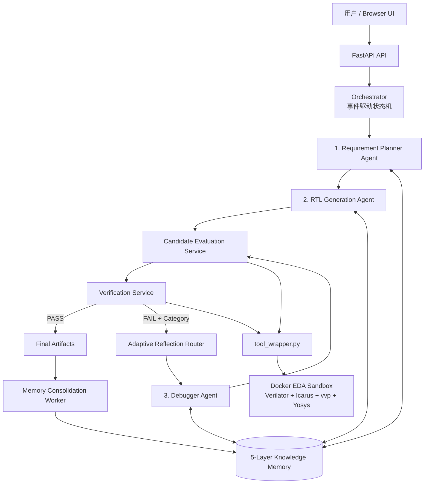

# VerilogCoder-MAGE Hybrid Multi-Agent RTL System

## 完整项目计划书 / 需求规格说明书（网页校正版）

> 版本：v2.1（轻量化三 Agent 实现版）  
> 编制日期：2026-08-19  
> 权威依据：用户提供的 Gemini 公开分享页“Verilog Agent System Design”完整 36 页内容  
> 项目仓库：`D:\AI\VerilogMulti\VerilogAgent`  
> 说明：本文档不使用工作区内 `verilog_agent_main_program.pdf` 的内容。

---

## 1. 项目概述

### 1.1 项目名称

VerilogCoder-MAGE Hybrid Multi-Agent RTL Generation and Repair System，简称 VerilogAgent。

### 1.2 建设目标

开发一个轻量化、高性能、可本地部署的多 Agent RTL 生成与修复系统。用户通过浏览器输入 Verilog/SystemVerilog 设计需求，系统自动完成需求规划、多候选生成、静态评分、EDA 验证、分类修复、迭代收敛和工程知识沉淀，最终输出可下载、可追溯、经过验证的 RTL 工程产物。实际实现只保留 Planner、Generator、Debugger 三个需要 LLM 推理的 Agent；评分、验证、路由和记忆整理均由确定性服务或后台任务承担。

系统吸收：

- VerilogCoder 的结构化需求规划思想，但删除复杂 TCRG，改用轻量 Task Tree。
- MAGE 的多候选并行探索、验证反馈和迭代修复思想。
- 本项目的两个主要创新：Static RTL Quality Score 与分层 Memory/Consolidation。
- 本项目的工程增强：Adaptive Reflection Router、Docker EDA 隔离、事件驱动状态机、Git 全生命周期管理和可复现实验。

### 1.3 核心价值

传统端到端 RTL 生成存在四类问题：需求理解丢失、单候选随机性、把“可编译”等同于“正确”、修复经验无法复用。本系统通过结构化任务树、候选竞争、工具评分、分类反射和可控记忆解决这些问题。

### 1.4 成功标准

- 系统可以通过 Docker Compose 启动，并在浏览器完成全流程。
- 固定需求下生成 2-3 个候选，并输出可解释的质量分数和选择理由。
- lint、compile、simulate、quality evaluation、benchmark 均返回统一 JSON。
- 修复策略能按语法、功能、需求/架构问题分类路由。
- 任务成功或终止后，后台记忆整理不阻塞前台任务。
- 每次运行可追溯到模型配置、工具版本、评分配置和 Git commit。
- 在固定 benchmark 上证明评分和记忆对通过率、迭代次数或成本具有正收益。

---

## 2. 项目范围

### 2.1 MVP 范围

- 单模块及小型多模块 Verilog/SystemVerilog 设计。
- 组合逻辑、计数器、移位寄存器、FIFO、FSM、握手接口和简单流水线。
- 用户提供 testbench，或系统依据规格生成基础 testbench。
- Verilator lint、Icarus Verilog compile/vvp simulate、Yosys 快速综合。
- OpenAI-compatible 模型接口，预留本地模型适配。
- SQLite、文件系统和 SQLite FTS5 实现轻量存储与检索。
- 浏览器任务提交、过程查看、候选对比、评分展示和结果下载。

### 2.2 暂不纳入 v1.0

- 完整 SoC 自动设计、CDC/RDC 签核、布局布线和商用 EDA 流程。
- 对 PPA 的工业级精确预测；Yosys 结果仅作为相对 benchmark。
- 大规模分布式 Agent 集群。
- 基础模型训练或微调。
- 让 Agent 自由执行 Shell 命令。
- 复杂 TCRG 和高成本 AST Waveform 模块。

---

## 3. 总体架构



### 3.1 架构组成

系统由以下部分组成：

1. 三个核心 LLM Agent：Planner、Generator、Debugger。
2. 两个确定性服务：Candidate Evaluation Service、Verification Service。
3. 一个后台 Memory Consolidation Worker。
4. Adaptive Reflection Router。
5. 事件驱动 Orchestrator。
6. 五类知识记忆库。
7. Docker 内的 EDA 执行与分析桥 `tool_wrapper.py`。
8. FastAPI、浏览器 UI、SQLite 和任务产物目录。

### 3.2 轻量化原则

- Agent 数量固定为三个，不允许运行时无限派生。
- 网页方案中的 Candidate Evaluation Agent 和 Verification Agent 降级为普通服务，因为它们的核心工作是规则计算、工具调用和状态判定，不需要独立人格或 LLM 对话。
- Agent 不直接互相调用，只能读写受控的 `RTLTaskContext` 并发送事件。
- 默认候选数为 2，研究模式最多 3；修复默认最多 3 轮。
- 使用 SQLite/FTS5 起步，不在 MVP 引入独立向量数据库。
- 先对全部候选执行接口检查、静态评分和快速 lint，再按排序依次进入成本较高的编译、仿真和综合阶段；排名第一的候选失败时，在预算内回退验证下一候选，不能仅凭静态分永久淘汰其余候选。
- Memory Consolidation 作为异步 Worker 执行，不调用 LLM 也能完成基础去重、统计和降权；只有需要把多条成功经验泛化成自然语言策略时才可选调用一次模型。
- MVP 的 Event Bus 是进程内类型化事件分发器与 SQLite 事件记录，不引入 Redis、Kafka 或独立消息服务。

---

## 4. 三个核心 Agent 与两个确定性服务

### 4.0 为什么从五 Agent 缩减为三 Agent

网页中的五个角色划分在概念上是正确的，但“角色”不等于必须实现为 LLM Agent。Candidate Evaluation 的本质是规则评分，Verification 的本质是执行 EDA 工具和判定状态；把它们做成 Agent 会增加模型调用、上下文传递、延迟和不可复现性，却不会提高正确率。因此本项目保留五项职责，但只将需要开放式推理的 Planner、Generator、Debugger 实现为 Agent。

| 网页角色 | 轻量化实现 | 功能是否保留 |
|---|---|---|
| Requirement Planner Agent | Planner Agent | 完整保留 |
| RTL Generation Agent | Generator Agent | 完整保留 |
| Candidate Evaluation Agent | Candidate Evaluation Service | 完整保留，且更确定 |
| Verification Agent | Verification Service | 完整保留，且更可靠 |
| Repair Agent | Debugger Agent | 完整保留 |
| Memory Consolidation Agent | Background Worker | 完整保留，LLM 泛化为可选能力 |

### 4.1 Requirement Planner Agent

职责：把原始 Specification 转换为轻量 Task Tree，而不是 VerilogCoder 的复杂 TCRG。

输入：

- 自然语言设计规格。
- 接口、时钟、复位、时序和资源约束。
- Project Memory 中已有模块/IP 的接口和摘要。

输出：

- `SpecIR`：结构化需求。
- `TaskTree`：层次任务树。
- 每个节点的输入、输出、时钟域、复位和断言要求。
- 需求歧义、工程假设和验收点。

约束：Planner 不生成最终 RTL，不得把未确认的关键假设当成事实。

### 4.2 RTL Generation Agent

职责：依据 Task Tree 和 Design Pattern Memory 并行生成 2-3 个完整候选。

候选应体现受控差异，例如：

- 两段式与三段式 FSM。
- 不同流水级或缓存组织。
- 不同但合法的控制/数据通路组织。

输出：候选 RTL、设计假设、采用的设计模式、模块依赖和代码哈希。

约束：不能修改规格、测试 oracle 或调用任意 Shell。

### 4.3 Candidate Evaluation Service

职责：在昂贵验证前，对全部候选执行接口检查和 Static RTL Quality Score，筛出最适合进入 Verification 的候选。

它调用 `tool_wrapper.py eval_quality`，而不是依靠 LLM 主观打分。主要检查：

- 复位形式是否符合规格。
- Latch 风险。
- case/if 赋值是否完备。
- 时序逻辑是否错误使用阻塞赋值。
- 组合逻辑是否错误使用非阻塞赋值。
- 未使用、未驱动和隐式信号。
- 多驱动、位宽、组合环和不可综合结构。
- 接口、模块名、端口方向和位宽是否匹配。

输出：每个候选的 `ScoreCard`、扣分证据、是否达到阈值和排序结果。

### 4.4 Verification Service

职责：按 Candidate Evaluation 给出的排序对候选执行分阶段验证。默认从第一名开始；若其未通过功能验证，则在剩余预算内继续验证下一候选，再决定进入 Debugger 修复的 Active Candidate。

推荐顺序：

```text
Interface Check
  -> Verilator Lint
  -> Icarus Compile
  -> vvp Simulation
  -> Yosys Benchmark
```

输出：统一的 `ToolResult`、验证阶段、错误分类、原始日志引用、波形/综合产物和最终 verdict。

Verification 必须识别：

- 非零退出码。
- testbench stdout 中的 `FAIL`、`Mismatch`、`ASSERTION FAILED` 等。
- `$fatal`。
- 超时和可能的死锁。
- X/Z、接口不匹配和 benchmark 越界。

Verification 必须同时记录 testbench 来源和验证置信度，不能把“系统自生成 testbench 通过”描述为绝对功能正确：

| 置信度 | Testbench 来源 | 报告要求 |
|---|---|---|
| `HIGH` | 用户或 benchmark 提供的 golden testbench | 可报告通过指定权威测试，但仍需列出覆盖边界 |
| `MEDIUM` | 从已确认 `SpecIR` 派生断言，并由独立流程生成 testbench | 报告断言集合、覆盖点和未验证行为 |
| `LOW` | 同一模型或同一上下文同时生成 RTL 与 testbench | 只能报告自洽性验证，不得宣称功能已被充分证明 |

### 4.5 Debugger Agent

职责：根据 Router 选择的专用 Reflection Policy，对当前最佳候选进行局部、可回滚的修复。

输入：当前 RTL、错误分类、最小必要日志、相关 Memory、允许修改范围和剩余预算。

输出：unified diff、修改理由、预期影响和风险。

约束：

- 优先最小补丁，不默认整文件重写。
- 不得修改 testbench oracle 来掩盖错误。
- 不得修改已确认接口，除非 Router 判定为 Requirement Reflection 且用户批准规格变更。
- 修复后必须重新评分和验证；得分退步或错误阶段倒退时回滚。

---

## 5. Adaptive Reflection Router

Router 是确定性决策模块，不必做成新的 LLM Agent。

| 失败现象 | Category | Reflection Policy | 修复重点 |
|---|---|---|---|
| Lint/Compile 失败、未定义信号、位宽、多驱动 | `SYNTAX_ERROR` / `LINT_RISK_ERROR` | Syntax Reflection | 语法、类型、声明、赋值和敏感列表；禁止发散修改数据通路 |
| 仿真断言、时序偏移、握手死锁、超时 | `SIMULATION_FUNCTIONAL_FAIL` / `SIMULATION_TIMEOUT` | Functional Reflection | FSM、延迟、valid/ready、边界条件和时序行为 |
| 面积、资源或性能约束越界 | `BENCHMARK_BOUNDS_EXCEEDED` | Requirement Reflection | 流水化、资源共享、微架构与约束权衡 |
| 工具缺失、路径错误、容器故障 | `SYSTEM_ERROR` | Infrastructure Recovery | 不调用 Debugger Agent，修复运行环境或终止任务 |

Requirement Reflection 不等于擅自放宽需求。若需要改变用户约束，任务进入 `WAITING_FOR_USER`。

---

## 6. 创新点一：Static RTL Quality Score

### 6.1 设计目的

评分用于在仿真前比较 2-3 个候选，并为修复提供连续的进步信号。它不是功能正确性的替代品，也不能让高静态分候选绕过验证。

### 6.2 两级评分机制

第一级为硬门槛：

1. 路径和文件合法。
2. 接口与 `SpecIR` 一致。
3. 无致命 lint/compile 错误。
4. 仿真通过且无失败标记。
5. 如启用 benchmark，Yosys elaboration 成功。

第二级为分项分数：

```text
StaticScore = 100
              - ResetPenalty
              - LatchPenalty
              - CaseIncompletePenalty
              - AssignmentStylePenalty
              - UndrivenPenalty
              - UnusedPenalty
              - WidthPenalty
              - MultipleDriverPenalty
              - CombLoopPenalty
```

网页原方案可作为初始规则：LATCH -30、同步复位违例 -20、CASEINCOMPLETE -15、UNDRIVEN -15、COMBDLY/BLKSEQ -10、UNUSED -5。正式实现时权重必须配置化，并通过 benchmark 校准，不能写死为研究结论。

### 6.3 综合排序

候选选择采用词典序：

```text
(通过的最高硬门槛阶段, FunctionalPassRate, StaticScore,
 BenchmarkConstraintScore, SimplicityScore)
```

这保证“功能错误但静态分高”的候选不会超过功能正确候选。

### 6.4 评分输出

```json
{
  "candidate_id": "cand_02",
  "static_quality_score": 88,
  "threshold": 75,
  "is_acceptable": true,
  "deductions": [
    {"rule": "UNUSED", "penalty": 5, "evidence": "rtl.v:42"}
  ],
  "gate_stage": "LINT_PASSED",
  "config_version": "score-v1"
}
```

### 6.5 评分驱动的修复控制

- 首轮评估所有候选，选择越过最高门槛且总排序最佳者。
- 修复后只有越过新门槛或综合排序提升才接受。
- 连续两次没有提升、错误签名重复或预算耗尽时停止。
- 保留最佳历史候选，不允许一次失败修复覆盖可用版本。

---

## 7. 创新点二：五类 Memory 与后台整理

### 7.1 五类知识库

| Memory | 核心内容 | 使用阶段 |
|---|---|---|
| Design Pattern Memory | 流水线、握手、Gray Code、FIFO、FSM 等已验证范式 | Generation |
| Error Memory | 编译器、lint、仿真器的错误代码、Regex、上下文和根因 | Verification/Repair |
| Repair Strategy Memory | 错误到修复算子的映射及适用条件 | Repair |
| Project Memory | 当前项目已验证模块、接口、参数、依赖和约定 | Planner/Generation |
| Human Intervention Memory | 人工修改 diff、批注、最终验证结果 | Repair，高权重但仍需复验 |

### 7.2 运行时分层

- Working Memory：当前一次模型调用所需的最小上下文。
- Episodic Memory：单任务的候选、错误、补丁和分数轨迹。
- Long-term Knowledge：上述五类跨任务知识。

五类知识是内容分类，三层记忆是生命周期分类，两者不冲突。

### 7.3 Memory Consolidation Worker

该 Agent 是后台异步任务，不进入前台关键路径。

触发条件：任务成功，或任务达到上限后终止。

职责：

- 聚类相似记录。
- 去重不同工具版本造成的同质描述。
- 把多个成功 repair diff 泛化为有适用条件的 Repair Strategy。
- 计算置信度、历史收益和版本兼容性。
- 降权造成负迁移的知识。

### 7.4 写入门控

- 成功通过更高验证阶段，或最终任务通过，才可生成正向长期记忆。
- 普通失败保留在 Episodic Memory，不直接成为推荐策略。
- Human Intervention 必须记录人工说明和之后的 EDA 证据。
- API key、隐私信息、绝对用户路径和大段原始代码不得进入长期记忆。
- 每条长期记忆必须有来源任务、工具版本、适用条件、证据哈希和置信度。

### 7.5 轻量检索

MVP 采用 SQLite 元数据过滤 + FTS5/BM25：

1. 按模块类型、错误代码、工具和项目过滤。
2. 全文检索候选知识。
3. 按错误签名匹配、历史成功率、时效性和版本一致性重排。
4. 最多向 Agent 注入 3-5 条短记忆。

后续只有在数据量和语义召回测试证明有必要时，才接入向量数据库。

---

## 8. 事件驱动协作与状态模型

### 8.1 RTLTaskContext

```json
{
  "task_id": "TASK_AXI_FIFO_001",
  "current_stage": "VERIFICATION_FAIL",
  "spec_ir_version": 2,
  "task_tree_root": {},
  "selected_candidate_id": "cand_02",
  "static_quality_score": 88.5,
  "execution_diagnostics": {
    "tool": "verilator",
    "exit_code": 1,
    "category": "LINT_RISK_ERROR",
    "evidence_path": "tool_runs/lint_003.json"
  },
  "reflection_policy": "SYNTAX_REFLECTION",
  "patch_diff_history": [],
  "budget": {"max_candidates": 3, "max_repairs": 3}
}
```

大段 RTL、日志和波形不放入事件总线，只保存 artifact 引用，避免上下文膨胀。MVP 中的事件总线为同一 Python 进程内的类型化发布/订阅接口，事件同步写入 SQLite；只有实测并发瓶颈证明有必要时，才引入外部消息中间件。

### 8.2 关键事件

- `EVENT_TASK_CREATED`
- `EVENT_PLAN_DONE`
- `EVENT_CANDIDATES_GENERATED`
- `EVENT_EVAL_PASSED` / `EVENT_EVAL_REJECTED`
- `EVENT_VERIFY_PASSED` / `EVENT_VERIFY_FAILED`
- `EVENT_REPAIR_PROPOSED`
- `EVENT_PATCH_ACCEPTED` / `EVENT_PATCH_ROLLED_BACK`
- `EVENT_SYSTEM_SUCCESS`
- `EVENT_BUDGET_EXHAUSTED`
- `EVENT_MEMORY_CONSOLIDATION_QUEUED`

### 8.3 状态机

```text
CREATED
 -> SPECIFYING
 -> PLANNED
 -> GENERATING
 -> EVALUATING
 -> VERIFYING
      -> COMPLETED
      -> CLASSIFYING
          -> REPAIRING
          -> EVALUATING

任意阶段 -> CANCELLED / FAILED / WAITING_FOR_USER
```

---

## 9. tool_wrapper.py 定位与规格

`tool_wrapper.py` 不是 Agent，而是 Docker 内部的 Physical Execution & Analysis Bridge。它负责调用 EDA 工具、约束运行、解析日志并输出标准 JSON。

### 9.1 必需命令

```text
lint          -> Verilator
compile       -> Icarus Verilog
simulate      -> vvp
eval_quality  -> 规则 + Verilator 结构化评分
benchmark     -> Yosys 快速综合与资源统计
```

### 9.2 统一 ToolResult

```json
{
  "status": "FAIL",
  "action": "simulate",
  "tool": "vvp",
  "tool_version": "...",
  "exit_code": 0,
  "timed_out": false,
  "duration_ms": 422,
  "category": "SIMULATION_FUNCTIONAL_FAIL",
  "errors": [],
  "stdout_path": "...",
  "stderr_path": "...",
  "artifacts": []
}
```

### 9.3 必须修复的现有缺口

- `subprocess.run` 必须设置 timeout 并终止子进程树。
- `simulate` 必须解析 stdout 中的断言失败，不能只看退出码。
- 固定 `sim.out` 改为任务/候选唯一输出路径。
- 所有输入路径必须解析并校验在当前任务 workspace 内。
- 限制日志大小，防止超大 stdout/stderr 耗尽资源。
- Docker 镜像层负责安装固定版本 EDA 工具、创建非 root 用户、设置工作目录和最小文件权限。
- Docker 运行策略层通过 Docker Compose 或容器启动参数设置禁网、只读根文件系统、临时可写工作卷、CPU/内存/PID 限制和超时；这些限制不能只依赖 Dockerfile。
- 不接受原始 Shell 字符串，只接受白名单 action 和参数数组。
- Benchmark 应准确描述为 Yosys 资源/结构估算；没有目标工艺库和 STA 时不得宣称得到了真实 Fmax、功耗或关键路径时延。

---

## 10. 功能需求

### 10.1 需求规划

- FR-001：接收自然语言、端口表、时钟复位和资源/性能约束。
- FR-002：生成 schema 校验的 `SpecIR` 和 Task Tree。
- FR-003：显示歧义和假设，支持用户确认。
- FR-004：查询 Project Memory，避免重复生成已有 IP。

### 10.2 多候选生成

- FR-010：每次生成 2-3 个可区分候选。
- FR-011：保存候选 ID、父版本、提示版本、模型参数和代码哈希。
- FR-012：候选必须遵循已确认的接口契约。

### 10.3 评估和验证

- FR-020：对所有候选执行接口与静态评分。
- FR-021：按硬门槛和综合分选择 Active Candidate。
- FR-022：执行 lint、compile、simulate 和可选 benchmark。
- FR-023：每项结果可追溯到原始证据文件。
- FR-024：评分规则、阈值和工具版本可配置、可版本化。

### 10.4 分类修复

- FR-030：根据 category 自动选择 Reflection Policy。
- FR-031：Debugger Agent 输出可审计 diff。
- FR-032：补丁应用后必须重新走评估/验证。
- FR-033：保存最佳版本并支持自动回滚。
- FR-034：达到预算或无进展时停止并解释原因。

### 10.5 记忆

- FR-040：支持五类 Memory 的存储、检索和来源追踪。
- FR-041：任务内保存完整修复轨迹。
- FR-042：后台执行聚类、去重、泛化和降权。
- FR-043：用户可查看、禁用、删除或固定记忆。
- FR-044：支持 `off/read_only/read_write` 三种模式。

### 10.6 Web 产品

- FR-050：创建任务和确认规格。
- FR-051：实时查看阶段、事件、候选和评分。
- FR-052：对比候选代码与分数。
- FR-053：查看错误分类、Reflection Policy 和 patch diff。
- FR-054：下载 RTL、testbench、报告、日志、波形和 ZIP。
- FR-055：查看任务历史和 Memory 命中。

---

## 11. 非功能需求

- NFR-001 轻量：默认仅 API/Web/EDA Worker，SQLite + 本地卷。
- NFR-002 性能：不含模型延迟，lint/compile 简单任务 P95 目标小于 5 秒。
- NFR-003 并发：MVP 至少支持 2 个任务，产物完全隔离。
- NFR-004 安全：生成代码只在受限 Docker 中执行。
- NFR-005 可恢复：服务重启后可从检查点恢复合法任务。
- NFR-006 可复现：记录模型、提示、评分、工具镜像和 Git SHA。
- NFR-007 可观察：结构化事件包含 task/run/candidate/stage。
- NFR-008 可测试：核心状态机、评分、路由、记忆门控覆盖率目标 ≥80%。
- NFR-009 可维护：领域层不依赖 FastAPI 或具体模型 SDK。
- NFR-010 可解释：最终选择和每次修复都有证据与理由。

---

## 12. 数据与目录设计

### 12.1 核心数据对象

- `Task`
- `SpecIR`
- `TaskTreeNode`
- `Candidate`
- `ToolRun`
- `ScoreCard`
- `RepairAttempt`
- `MemoryItem`
- `HumanIntervention`
- `Event`
- `Artifact`

### 12.2 推荐仓库结构

```text
VerilogAgent/
  apps/
    api/
    web/
  verilog_agent/
    domain/
    agents/
      planner.py
      generator.py
      debugger.py
    evaluation/
      candidate_evaluator.py
      verifier.py
    workers/
      memory_consolidator.py
    orchestration/
      state_machine.py
      event_bus.py
      reflection_router.py
      budget.py
    scoring/
    memory/
    providers/
    storage/
    tools/
  sandbox/
    Dockerfile
    tool_wrapper.py
  deploy/
    docker-compose.yml
  tests/
    unit/
    integration/
    e2e/
    benchmarks/
  docs/
  pyproject.toml
  .env.example
```

运行产物放入 `runs/<task_id>/`，必须被 `.gitignore` 排除。

---

## 13. API 设计

| 方法 | 路径 | 功能 |
|---|---|---|
| POST | `/api/tasks` | 创建任务 |
| GET | `/api/tasks/{id}` | 任务详情 |
| GET | `/api/tasks/{id}/events` | SSE 事件流 |
| POST | `/api/tasks/{id}/confirm-spec` | 确认规格 |
| POST | `/api/tasks/{id}/cancel` | 取消 |
| POST | `/api/tasks/{id}/retry` | 从检查点重试 |
| GET | `/api/tasks/{id}/candidates` | 候选与分数 |
| GET | `/api/tasks/{id}/artifacts` | 产物清单 |
| GET | `/api/tasks/{id}/download` | 下载 ZIP |
| GET | `/api/memories` | 查询记忆 |
| DELETE | `/api/memories/{id}` | 删除记忆 |
| GET | `/healthz` | 健康检查 |

---

## 14. Git 管理方案

### 14.1 仓库边界

产品仓库是 `D:\AI\VerilogMulti\VerilogAgent`。父目录中的 MAGE、VerilogCoder、论文和 PDF 不进入产品仓库。

### 14.2 分支

- `main`：始终可运行，只通过 PR 合并。
- `feat/<issue>-<name>`：功能。
- `fix/<issue>-<name>`：修复。
- `docs/<issue>-<name>`：文档。
- 不设长期 `develop`，降低单人开发复杂度。

### 14.3 提交规范

使用 Conventional Commits：

```text
feat(scoring): add configurable RTL quality rules
fix(sandbox): terminate timed-out simulation process tree
test(memory): cover negative-transfer demotion
docs(architecture): document five-agent event flow
```

每个提交应是小型、可测试、可回滚的垂直切片。

### 14.4 里程碑标签

```text
v0.0.1-prototype
v0.1.0-sandbox
v0.2.0-orchestrator
v0.3.0-three-agents
v0.4.0-scoring
v0.5.0-reflection-repair
v0.6.0-memory
v0.7.0-api
v0.8.0-web
v0.9.0-rc1
v1.0.0
```

### 14.5 CI 合并条件

- Ruff/formatter。
- mypy 或 Pyright。
- 单元测试。
- Docker EDA smoke test。
- 核心集成测试。
- 不包含 secrets、运行产物或超大文件。

### 14.6 当前 Git 起点

产品仓库已经在 `MANTOKA/verilog-agent` 创建为私有仓库，本地 `main` 跟踪 `origin/main`。首次基线提交为 `3c21a94 Establish initial VerilogAgent baseline`，提交身份为 `mantoka <shichao716@outlook.com>`。父目录中的论文、MAGE 和 VerilogCoder 参考源码不属于产品仓库。当前尚未创建 `v0.0.1-prototype` 标签；应在 V2.1 权威项目书、自动化基线测试和最小工程配置合并后创建该标签，避免把仅有手工验证的状态标记为可复现里程碑。

---

## 15. 12 周开发计划

网页原计划分为 3 个阶段、9 周。本说明书保留三个阶段的核心内容，并增加 3 周用于 Web、部署、安全和正式评测，使其成为可交付产品计划。

### Phase 0：项目基线（第 1 周）

任务：

- 建立 Git 首次提交、Issue/PR 模板、CI。
- 固化 Python 工程结构、依赖、配置和日志规范。
- 为现有 wrapper 建立行为基线测试。

交付：`v0.0.1-prototype`。

验收：main 可运行、测试可复现、研究材料不在仓库内。

### Phase 1：基础设施和工具链（第 2-3 周）

第 2 周：安全 EDA 沙箱

- 改造 Dockerfile：Icarus、Verilator、Yosys、非 root。
- 独立任务 workspace、禁网、资源/PID/时间限制。
- 修复 timeout、唯一输出文件和路径约束。

第 3 周：统一工具接口

- 实现 lint/compile/simulate/eval_quality/benchmark。
- 统一 ToolResult 和 category taxonomy。
- 增加断言失败、FAIL 文本、超时和系统错误测试。

交付：`v0.1.0-sandbox`。

### Phase 2：三 Agent 与确定性服务闭环（第 4-7 周）

第 4 周：领域模型和 Orchestrator

- 实现 SpecIR、Task Tree、RTLTaskContext、Candidate 和 Event。
- 实现状态机、预算、取消、检查点和事件持久化。
- 用 Fake Agent 跑通全流程。

第 5 周：Planner 与 Generator

- 实现 OpenAI-compatible Provider。
- Planner 输出 schema 校验的 SpecIR/Task Tree。
- Generator 生成 2-3 个差异候选并去重。

第 6 周：Candidate Evaluation 与评分创新

- 实现接口硬门槛和静态评分规则。
- 实现词典序排序、阈值、ScoreCard 和报告。
- 对规则权重做基准校准。

第 7 周：Verification、Router 与 Repair

- 实现完整验证流水线。
- 实现 Syntax/Functional/Requirement Reflection 路由。
- 实现局部 diff、重新评估、接受/回滚和停滞停止。

交付：`v0.5.0-reflection-repair`。

### Phase 3：Memory 与收敛评测（第 8-9 周）

第 8 周：任务内记忆和五类存储

- SQLite schema、artifact repository、候选谱系和修复轨迹。
- 五类 Memory 的数据结构、来源和用户管理。
- 任务重放和进程重启恢复。

第 9 周：Memory Consolidation

- 异步整理队列。
- 去重、聚类、泛化、置信度和负收益降权。
- FTS5 检索和上下文预算。
- 无记忆/任务内记忆/长期记忆初步 A/B。

交付：`v0.6.0-memory`。

### Phase 4：产品化（第 10-11 周）

第 10 周：API 与 Web UI

- FastAPI 任务、事件、候选、Memory 和下载接口。
- SSE 实时进度。
- UI 展示 SpecIR、Task Tree、候选评分、错误、diff 和产物。

第 11 周：Docker Compose 和安全性能

- API/Web/EDA Worker 一键启动。
- 两任务并发测试、日志轮转、故障注入和安全测试。
- 完善 `.env.example`、健康检查和部署文档。

交付：`v0.9.0-rc1`。

### Phase 5：正式评测和发布（第 12 周）

- 固定 benchmark 和实验协议。
- 运行评分、Router、Memory 的消融实验。
- 输出通过率、修复轮数、token、时间、负迁移和错误分布。
- 完成用户手册、开发手册、架构决策记录和演示。

交付：`v1.0.0`。

---

## 16. 可直接建立的任务清单

### Epic A：Repository & CI

- A01 配置本地 Git identity。
- A02 审查 `.gitignore/.dockerignore`。
- A03 建立 baseline commit/tag。
- A04 添加 `pyproject.toml`、Ruff、类型检查和 pytest。
- A05 建立 PR/Issue 模板和 CI。

### Epic B：EDA Sandbox

- B01 统一 `ToolResult`。
- B02 subprocess timeout 和子进程树终止。
- B03 任务路径白名单。
- B04 唯一输出和并发隔离。
- B05 vvp assertion/FAIL 解析。
- B06 Verilator category 解析。
- B07 Yosys benchmark。
- B08 非 root、禁网和资源限制。

### Epic C：Domain & Orchestration

- C01 SpecIR schema。
- C02 Task Tree schema。
- C03 RTLTaskContext/Event schema。
- C04 状态机。
- C05 budget/early-stop。
- C06 checkpoint/recovery。

### Epic D：Three Agents and Deterministic Services

- D01 Planner。
- D02 Generator。
- D03 Candidate Evaluation Service。
- D04 Verification Service。
- D05 Debugger Agent。
- D06 Agent schema-output repair。

### Epic E：Scoring

- E01 接口硬门槛。
- E02 Static RTL rule registry。
- E03 configurable weights。
- E04 ScoreCard。
- E05 ranking/threshold。
- E06 score delta 和 rollback。
- E07 benchmark 校准。

### Epic F：Adaptive Reflection

- F01 error taxonomy。
- F02 Syntax Reflection 模板。
- F03 Functional Reflection 模板。
- F04 Requirement Reflection 模板。
- F05 system error bypass。
- F06 no-progress detection。

### Epic G：Memory

- G01 episodic trace。
- G02 五类 Memory schema。
- G03 write gate。
- G04 FTS5 retrieval。
- G05 Memory Consolidation worker。
- G06 dedup/generalization。
- G07 negative transfer demotion。
- G08 user inspect/delete/pin。

### Epic H：API/UI/Deployment

- H01 task API。
- H02 SSE events。
- H03 candidate/score API。
- H04 artifact download。
- H05 browser workflow。
- H06 candidate comparison。
- H07 memory management UI。
- H08 Docker Compose。

### Epic I：Evaluation

- I01 benchmark corpus。
- I02 baseline without score/memory。
- I03 scoring ablation。
- I04 memory ablation。
- I05 Router ablation。
- I06 reproducible report。

---

## 17. 测试和实验设计

### 17.1 测试层次

- 单元测试：解析、评分、状态迁移、路由、记忆门控。
- 集成测试：真实 Docker 工具链、SQLite、Fake LLM。
- 端到端测试：浏览器输入到 ZIP 下载。
- 安全测试：路径穿越、无限仿真、超大日志、fork bomb、网络访问。
- 回归基准：组合逻辑、FSM、FIFO、握手、流水线和故意注入缺陷。

### 17.2 指标

- pass@1、pass@2、pass@3 和最终通过率。
- 接口合规、lint、compile、simulation、synthesis 成功率。
- 平均候选数、修复轮数、LLM 调用、token 和墙钟时间。
- StaticScore 与最终功能通过的相关性。
- Router 分类准确率和不必要修改率。
- Memory 检索命中率、正收益率、负迁移率和错误复发率。
- 人工介入率和人工修改后的复验通过率。

### 17.3 消融组

1. 单候选 + 无评分 + 无记忆。
2. 多候选 + 无评分。
3. 多候选 + 静态评分。
4. 多候选 + 评分 + Adaptive Reflection。
5. 多候选 + 评分 + Reflection + 任务内记忆。
6. 完整五类长期 Memory + Consolidation。

固定模型、提示版本、温度、预算和工具镜像，至少重复三次并报告均值与标准差。

---

## 18. 风险和控制

| 风险 | 控制措施 |
|---|---|
| 正则评分误判 RTL | Verilator/Yosys 为主要证据；正则仅补充；规则版本化并测试 |
| 静态高分但功能错误 | 硬门槛优先，Simulation verdict 权重最高 |
| 生成 testbench 错误 | SpecIR 派生断言、testbench 自检、用户 TB 优先、Repair 不可改 oracle，并在报告中标注 `HIGH/MEDIUM/LOW` 验证置信度 |
| Repair 破坏正确逻辑 | 最小 diff、score delta、完整重验、最佳候选回滚 |
| Memory 污染 | 成功门控、来源追踪、置信度、负迁移降权和人工删除 |
| Human Memory 被过度信任 | 高检索优先级但仍必须经过当前工具链复验 |
| Yosys 指标被误称为真实 PPA | 报告明确工具、工艺假设和指标边界 |
| Agent 过多导致延迟 | 固定三个 LLM Agent；Evaluator/Verifier 程序化；Consolidation 作为异步 Worker |
| 恶意 RTL/testbench | 镜像层使用非 root 和最小权限；运行策略层设置禁网、只读根、独立工作卷、资源和超时限制 |
| Git 无法回滚 | 小提交、PR、CI、里程碑标签和数据库迁移 |

---

## 19. Definition of Done

任务只有满足以下要求才能关闭：

- 关联 Issue 和明确验收标准。
- 实现、测试和文档一起提交。
- 格式、类型、单元和相关集成测试通过。
- 失败路径、超时和回滚已验证。
- 不写出任务目录、不泄漏密钥、不污染并发任务。
- schema/config 变更有版本和迁移说明。
- PR 合并后 main 可运行。

---

## 20. 你应该怎样开始

第一批不要开发全部 Agent。按以下顺序完成最小纵向切片：

1. 建立 Git baseline。
2. 修复现有 `tool_wrapper.py` 的 timeout、仿真失败判定、唯一输出和路径隔离。
3. 定义 `ToolResult`、`SpecIR`、`Candidate` 和 `ScoreCard`。
4. 使用固定样例实现两个候选的 `eval_quality -> lint -> compile -> simulate` 排序。
5. 用 Fake Planner/Generator/Repairer 跑通状态机和回滚。
6. 再逐个替换为真实 LLM Agent。

第一个可演示版本应完成：输入一个计数器需求，系统产生两个候选，静态评分选出一个，完成编译和仿真；若失败则分类并修复一次；所有过程写入事件和 Git 可复现配置。这个纵向切片完成后，再扩展 Memory、API 和 UI。

---

## 21. v1.0 最终验收

在干净机器上：

1. 克隆 `v1.0.0`。
2. 复制 `.env.example` 并填写模型配置。
3. 执行 `docker compose up --build`。
4. 浏览器输入 FIFO/FSM/计数器需求。
5. 查看 Task Tree、2-3 个候选、StaticScore 和选择理由。
6. 查看 Verification 的 lint/compile/simulate/benchmark 证据。
7. 故意触发语法或功能错误，观察 Router 选择不同 Reflection Policy。
8. 修复成功后查看 patch、score delta 和回滚点。
9. 下载 RTL、testbench、报告、日志和 ZIP。
10. 查看五类 Memory 的来源；关闭记忆后系统仍可运行。
11. 重启服务后任务可恢复。
12. 基准报告能够证明评分和记忆的实际收益及其限制。

完成以上场景，项目才达到“轻量、高性能、可解释、可积累经验”的多 Agent RTL 系统目标。
