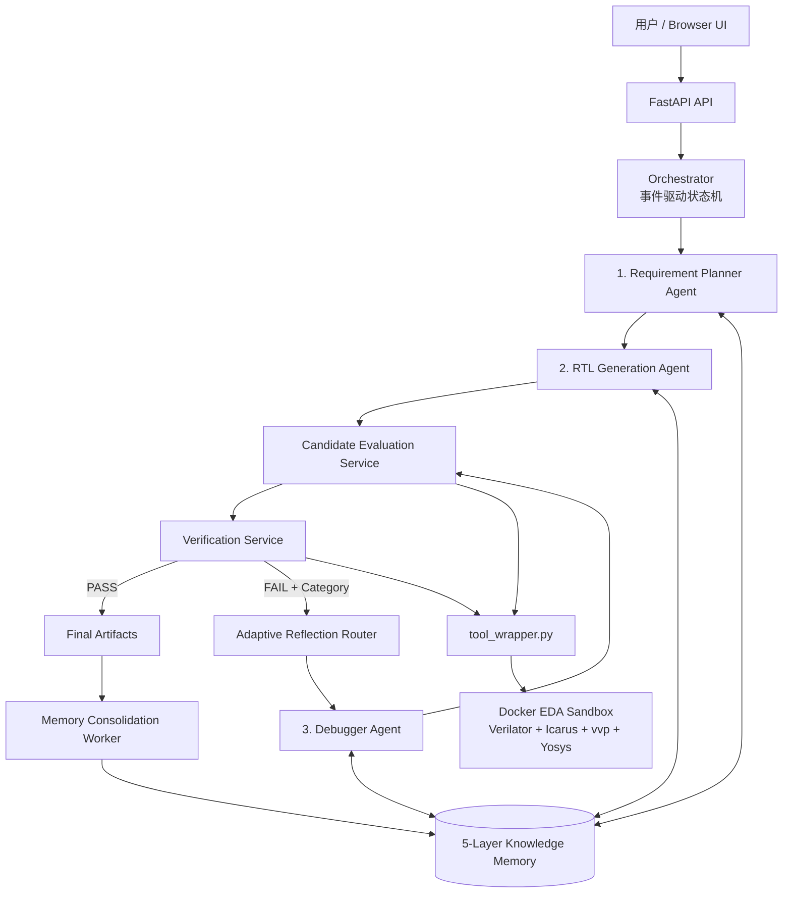

# RTLForge 原始项目书与验收目标

> 2026-10-28 发布校对：本篇保留原设计/历史实验的日期、指标与协议；其中阶段性状态不代表当前实现。当前完成范围见[验收矩阵](../STATUS_ZH.md)。

## 完整项目计划书 / 需求规格说明书（来源溯源与进度校正版）

> 原始计划版本：v2.5；2026-10-28发布校对：保留原验收目标，当前状态另列
>
> 初版日期：2026-08-19
>
> 原始状态快照：2026-09-08（历史，不代表0.3.0现状）
> 权威依据：用户提供的 Gemini 公开分享页“RTLForge System Design”完整 36 页内容
> 项目仓库：`D:\AI\VerilogMulti\RTLForge`
> 说明：本文档不使用工作区内 `rtlforge_main_program.pdf` 的内容。

---

## 1. 项目概述

### 1.1 项目名称

VerilogCoder-MAGE Hybrid Multi-Agent RTL Generation and Repair System，简称 RTLForge。

### 1.2 建设目标

开发一个轻量化、高性能、可本地部署的多 Agent RTL 生成与修复系统。用户通过浏览器输入 Verilog/SystemVerilog 设计需求，系统自动完成需求规划、多候选生成、静态评分、EDA 验证、分类修复、迭代收敛和工程知识沉淀，最终输出可下载、可追溯、经过验证的 RTL 工程产物。实际实现只保留 Planner、Generator、Debugger 三个需要 LLM 推理的 Agent；评分、验证、路由和记忆整理均由确定性服务或后台任务承担。

系统吸收：

- VerilogCoder 的结构化任务分解、代码生成/调试分工和仿真/波形反馈思想；本项目不实现其 TCRG 和 AST-WT，而改用轻量 Task Tree 与结构化诊断。[VC]
- MAGE 的多候选采样、mismatch 驱动筛选、迭代修复和状态检查点思想。[MAGE]
- RTLFixer 的“编译器反馈 + LLM 修复”及检索增强修复思路。[RTLF]
- 本项目拟验证的两个主要创新：Static RTL Quality Score 驱动的候选选择，以及面向 RTL 的质量门控分层 Memory/Consolidation。[ORIG-SCORE][ORIG-MEM]
- 本项目的工程设计：三 LLM Agent 化、确定性 Evaluation/Verification、Adaptive Reflection Router、Docker EDA 隔离、事件状态机和 Git 全生命周期管理。[ORIG-ARCH][ENG]

### 1.3 核心价值

传统端到端 RTL 生成存在四类问题：需求理解丢失、单候选随机性、把“可编译”等同于“正确”、修复经验无法复用。本系统通过结构化任务树、候选竞争、工具评分、分类反射和可控记忆解决这些问题。

### 1.4 成功标准

- 系统可以通过 Docker Compose 启动，并在浏览器完成全流程。
- 固定需求下先生成 1 个候选，默认按需最多 2 个，第三个仅手动实验开放；输出质量分数与再生成理由。
- lint、compile、simulate、quality evaluation、benchmark 均返回统一 JSON。
- 修复策略能按语法、功能、需求/架构问题分类路由。
- 任务成功或终止后，后台记忆整理不阻塞前台任务。
- 每次运行可追溯到模型配置、工具版本、评分配置和 Git commit。
- 在固定 benchmark 上证明评分和记忆对通过率、迭代次数或成本具有正收益。

### 1.5 当前实施状态（2026-09-08）

本项目已经从方案阶段进入可运行原型阶段。下表以当前 Git 分支和测试结果为准，避免把计划功能误写成已完成功能。

| 模块 | 状态 | 当前证据或边界 |
|---|---|---|
| Git/GitHub、CI 与工程基线 | 已完成 | 私有远端、`main`、Issue/PR 模板、`pyproject.toml`、Ruff/pytest 已建立 |
| 安全 EDA 沙箱 | 已完成 | Dockerfile 集成 Icarus、Verilator、Yosys，具备非 root、路径检查、超时和结构化输出 |
| `tool_wrapper.py` 五类动作 | 已完成 | `lint/compile/simulate/eval_quality/benchmark` 已实现统一 `ToolResult` |
| 领域模型、状态机、事件与检查点 | 已完成 | `SpecIR/TaskTree/Candidate/RTLTaskContext`、SQLite 事件和恢复路径已实现 |
| Fake 闭环 | 已完成 | 成功、修复、预算耗尽、取消和恢复场景已有测试 |
| Real Planner Agent | 已完成第一版 | 严格结构化输出、本地校验、假设记录 |
| Real Generator Agent | 已完成第一版 | 多候选、路径安全、内容哈希和去重 |
| Candidate Evaluation Service | 已完成第一版 | 已接入 SpecIR 接口门禁、版本化 ScoreCard、阈值、扣分证据、排序和验证失败后的候选回退；`TOOL_INCOMPATIBILITY` 不再误拒绝可由 Icarus 验证的 RTL |
| Verification Service | 已完成第一版 | 支持 golden testbench、按评分顺序回退、证据报告和受控反馈；非零输出 mismatch 即使 aggregate 为零也不会误判 PASS |
| Debugger Agent 与 Reflection Router | 已完成第一版 | 支持 Syntax/Functional/Timeout/Requirement/Infrastructure 确定性路由、新 child candidate、可审计 diff、重评分、复验、回滚和修复预算 |
| 证据驱动 Memory | 三类已实现 | `DESIGN_PATTERN`、`ERROR_PATTERN`、`REPAIR_STRATEGY` 已接入在线门控与角色检索；支持同题隔离、support count、负迁移 `QUARANTINED` 和粗粒度策略 `SUPERSEDED` |
| Consolidation Worker 与完整五类 Memory | 部分完成 | 已有可重复运行的确定性离线 consolidation；`PROJECT`、`HUMAN_INTERVENTION` 专用 schema、异步队列、语义聚类和受控 A/B 尚未完成 |
| API、Browser UI、Docker Compose | 待完成 | 不属于当前可演示闭环 |
| VerilogEval-Human v2 工程评测 | 部分完成 | 156 题 triplet 完整；官方参考预检 154 PASS、2 项 Icarus cast 工具不兼容；首轮全量模型基线 145/154，定向复测回填为 152/154；尚无冻结元数据下的独立复现实验或消融 |

2026-09-08 当前工作区快速回归为 `122 passed, 13 skipped`，默认跳过的 13 项 Docker 集成测试另行显式执行为 `13 passed`。Prob104 的官方参考与修复后 Agent RTL 均在 golden testbench 上通过，Agent 经三轮 Debugger 从 `1/199` 收敛到 `0/199`。对 172 个已有任务摘要执行离线 consolidation 后，数据库包含 153 条去重 verified design pattern、13 类 error pattern 和 8 条 repair strategy（4 条 ACTIVE）。RTLLM 2.1 的 50 题适配器、单题 Demo 和可恢复逐题批量入口也已实现；官方参考预检为 47 PASS、3 项 Icarus/testbench 工具不兼容，并完成 1 个单题与 1 个批量烟雾测试，尚未执行完整模型评测。这些数字证明数据管线和单题检索闭环工作，不证明 Memory 提升总体通过率。Human v2 的首次顺序全量运行仍为 145/154 = 94.16%，定向复测回填仍为 152/154 = 98.70%；完整边界见 `HUMAN_V2_TWO_RUN_EVALUATION_REPORT_ZH.md`、`MEMORY_IMPLEMENTATION_ZH.md` 与 `RTLLM_EVALUATION_ZH.md`。

### 1.6 来源与原创标记规范

本文档从 v2.3 起使用以下标记，防止把工程选择或待验证假设误写成已有文献结论：

| 标记 | 含义 |
|---|---|
| `[VC]` | 直接来源或明确借鉴 VerilogCoder 论文/官方代码 |
| `[MAGE]` | 直接来源或明确借鉴 MAGE 论文/官方代码 |
| `[VE2]` | 来源于 VerilogEval v2 官方数据集、脚本或论文 |
| `[RTLF]` | 借鉴 RTLFixer 的编译反馈、RAG/ReAct 修复路线 |
| `[VERILATOR]` | 规则名称或语义来自 Verilator 官方诊断文档 |
| `[AGENT-MEM]` | 仅借鉴通用 Agent Memory 文献，不代表其验证了 RTL 场景 |
| `[ORIG-*]` | 本项目提出的机制或组合，尚需本项目实验验证 |
| `[ENG]` | 通用软件/EDA 工程设计，不主张为学术创新 |
| `[IMPL]` | 已在本仓库实现和测试的事实 |

“参考”分为三种强度：

1. **直接复现**：概念和运行方式与来源基本一致；必须给出具体来源。
2. **改造借鉴**：只继承目标或局部机制，数据结构、规则或实现由本项目重做。
3. **原创/工程假设**：来源没有提出该机制；必须写明验证计划，不能用来源论文的成绩为其背书。

除 `[IMPL]` 外，设计描述不代表已经实现；除已有论文明确消融外，引用也不代表该机制在本项目中必然有效。

---

## 2. 项目范围

### 2.1 MVP 范围

- 单模块及小型多模块 Verilog/SystemVerilog 设计。
- 组合逻辑、计数器、移位寄存器、FIFO、FSM、握手接口和简单流水线。
- 用户提供 testbench，或系统依据规格生成基础 testbench。
- Verilator lint、Icarus Verilog compile/vvp simulate、Yosys 快速综合。
- OpenAI-compatible 模型接口，预留本地模型适配。
- SQLite、文件系统和 SQLite FTS5 实现轻量存储与检索。
- 浏览器任务提交、过程查看、候选对比、评分展示和结果下载。

### 2.2 暂不纳入 v1.0

- 完整 SoC 自动设计、CDC/RDC 签核、布局布线和商用 EDA 流程。
- 对 PPA 的工业级精确预测；Yosys 结果仅作为相对 benchmark。
- 大规模分布式 Agent 集群。
- 基础模型训练或微调。
- 让 Agent 自由执行 Shell 命令。
- 复杂 TCRG 和高成本 AST Waveform 模块。

---

## 3. 总体架构



### 3.1 架构组成

系统由以下部分组成：

1. 三个核心 LLM Agent：Planner、Generator、Debugger。
2. 两个确定性服务：Candidate Evaluation Service、Verification Service。
3. 一个后台 Memory Consolidation Worker。
4. Adaptive Reflection Router。
5. 事件驱动 Orchestrator。
6. 五类知识记忆库。
7. Docker 内的 EDA 执行与分析桥 `tool_wrapper.py`。
8. FastAPI、浏览器 UI、SQLite 和任务产物目录。

### 3.2 轻量化原则

> 来源说明：三 Agent 化、确定性服务、SQLite/FTS5、SSE、候选数 2-3 和修复预算均为本项目工程设计，不是 VerilogCoder 或 MAGE 的原始结论。[ORIG-ARCH][ENG]

- Agent 数量固定为三个，不允许运行时无限派生。
- 网页方案中的 Candidate Evaluation Agent 和 Verification Agent 降级为普通服务，因为它们的核心工作是规则计算、工具调用和状态判定，不需要独立人格或 LLM 对话。
- Agent 不直接互相调用，只能读写受控的 `RTLTaskContext` 并发送事件。
- 初始候选数为 1，默认独立候选总上限为 2，手动研究模式最多 3；修复默认最多 3 轮，整题累计。
- 使用 SQLite/FTS5 起步，不在 MVP 引入独立向量数据库。
- 先对全部候选执行接口检查、静态评分和快速 lint，再按排序依次进入成本较高的编译、仿真和综合阶段；排名第一的候选失败时，在预算内回退验证下一候选，不能仅凭静态分永久淘汰其余候选。
- Memory Consolidation 作为异步 Worker 执行，不调用 LLM 也能完成基础去重、统计和降权；只有需要把多条成功经验泛化成自然语言策略时才可选调用一次模型。
- MVP 的 Event Bus 是进程内类型化事件分发器与 SQLite 事件记录，不引入 Redis、Kafka 或独立消息服务。

---

## 4. 三个核心 Agent 与两个确定性服务

### 4.0 为什么从五 Agent 缩减为三 Agent

网页中的五个角色划分在概念上是正确的，但“角色”不等于必须实现为 LLM Agent。Candidate Evaluation 的本质是规则评分，Verification 的本质是执行 EDA 工具和判定状态；把它们做成 Agent 会增加模型调用、上下文传递、延迟和不可复现性，却不会提高正确率。因此本项目保留五项职责，但只将需要开放式推理的 Planner、Generator、Debugger 实现为 Agent。

| 网页角色 | 轻量化实现 | 功能是否保留 |
|---|---|---|
| Requirement Planner Agent | Planner Agent | 完整保留 |
| RTL Generation Agent | Generator Agent | 完整保留 |
| Candidate Evaluation Agent | Candidate Evaluation Service | 完整保留，且更确定 |
| Verification Agent | Verification Service | 完整保留，且更可靠 |
| Repair Agent | Debugger Agent | 完整保留 |
| Memory Consolidation Agent | Background Worker | 完整保留，LLM 泛化为可选能力 |

### 4.1 Requirement Planner Agent

职责：把原始 Specification 转换为轻量 Task Tree，而不是 VerilogCoder 的复杂 TCRG。任务分解和规划/执行分离借鉴 VerilogCoder；用树替代 TCRG、`SpecIR` schema 和本地校验是本项目简化设计。[VC][ORIG-ARCH][IMPL]

输入：

- 自然语言设计规格。
- 接口、时钟、复位、时序和资源约束。
- Project Memory 中已有模块/IP 的接口和摘要。

输出：

- `SpecIR`：结构化需求。
- `TaskTree`：层次任务树。
- 每个节点的输入、输出、时钟域、复位和断言要求。
- 需求歧义、工程假设和验收点。

约束：Planner 不生成最终 RTL，不得把未确认的关键假设当成事实。

### 4.2 RTL Generation Agent

职责：依据 Task Tree 和 Design Pattern Memory 逐个生成独立候选。先生成 1 个，硬门禁失败或静态分 <75 时按需生成新候选；静态合格后先验证，功能失败优先 Debugger 修复，无进展或修复预算耗尽才重新生成。默认独立候选总上限 2，第三个仅手动指定开放，PASS 立即结束。修复预算整题累计，不随再生成重置。槽耗尽且静态仍不合格时，使用剩余修复预算处理静态问题。多候选探索动机借鉴 MAGE，顺序触发和低预算策略为本项目设计，节省 token 的幅度仍需实际评测。[MAGE][ORIG-ARCH][IMPL]

候选应体现受控差异，例如：

- 两段式与三段式 FSM。
- 不同流水级或缓存组织。
- 不同但合法的控制/数据通路组织。

输出：候选 RTL、设计假设、采用的设计模式、模块依赖和代码哈希。

约束：不能修改规格、测试 oracle 或调用任意 Shell。

### 4.3 Candidate Evaluation Service

职责：在昂贵验证前，对全部候选执行接口检查和 Static RTL Quality Score，筛出最适合进入 Verification 的候选。MAGE 使用仿真 mismatch 对候选排序，但没有提出本文的预验证静态加权分数；因此 StaticScore、接口门禁和评分排序属于本项目拟创新。[MAGE][ORIG-SCORE][IMPL]

它调用 `tool_wrapper.py eval_quality`，而不是依靠 LLM 主观打分。LATCH、CASEINCOMPLETE、COMBDLY、BLKSEQ、UNUSED、UNDRIVEN、WIDTH 等名称和基本语义来自 Verilator 官方 warning taxonomy；把这些诊断变成扣分项、阈值和候选排序是本项目设计。[VERILATOR][ORIG-SCORE]

- 复位形式是否符合规格。
- Latch 风险。
- case/if 赋值是否完备。
- 时序逻辑是否错误使用阻塞赋值。
- 组合逻辑是否错误使用非阻塞赋值。
- 未使用、未驱动和隐式信号。
- 多驱动、位宽、组合环和不可综合结构。
- 接口、模块名、端口方向和位宽是否匹配。

输出：每个候选的 `ScoreCard`、扣分证据、是否达到阈值和排序结果。

### 4.4 Verification Service

职责：按 Candidate Evaluation 给出的排序对候选执行分阶段验证。Icarus/testbench 验证来自 VerilogEval、VerilogCoder 和 MAGE 的共同实践；“接口→lint→compile→simulate→benchmark”的固定流水线、候选回退和统一 `ToolResult` 是本项目工程设计。[VE2][VC][MAGE][ENG][IMPL]

推荐顺序：

```text
Interface Check
  -> Verilator Lint
  -> Icarus Compile
  -> vvp Simulation
  -> Yosys Benchmark
```

输出：统一的 `ToolResult`、验证阶段、错误分类、原始日志引用、波形/综合产物和最终 verdict。

Verification 必须识别：

- 非零退出码。
- testbench stdout 中的 `FAIL`、`Mismatch`、`ASSERTION FAILED` 等。
- `$fatal`。
- 超时和可能的死锁。
- X/Z、接口不匹配和 benchmark 越界。

Verification 必须同时记录 testbench 来源和验证置信度，不能把“系统自生成 testbench 通过”描述为绝对功能正确：

| 置信度 | Testbench 来源 | 报告要求 |
|---|---|---|
| `HIGH` | 用户或 benchmark 提供的 golden testbench | 可报告通过指定权威测试，但仍需列出覆盖边界 |
| `MEDIUM` | 从已确认 `SpecIR` 派生断言，并由独立流程生成 testbench | 报告断言集合、覆盖点和未验证行为 |
| `LOW` | 同一模型或同一上下文同时生成 RTL 与 testbench | 只能报告自洽性验证，不得宣称功能已被充分证明 |

### 4.5 Debugger Agent

职责：根据 Router 选择的专用 Reflection Policy，对当前最佳候选进行局部、可回滚的修复。编译日志反馈借鉴 RTLFixer，仿真/波形反馈借鉴 VerilogCoder，mismatch 改善与 checkpoint 思路借鉴 MAGE；本文的统一 Debugger、child-candidate 谱系和接受/回滚条件是改造设计。[RTLF][VC][MAGE][ORIG-ROUTER][IMPL]

输入：当前 RTL、错误分类、最小必要日志、相关 Memory、允许修改范围和剩余预算。

输出：unified diff、修改理由、预期影响和风险。

约束：

- 优先最小补丁，不默认整文件重写。
- 不得修改 testbench oracle 来掩盖错误。
- 不得修改已确认接口，除非 Router 判定为 Requirement Reflection 且用户批准规格变更。
- 修复后必须重新评分和验证；得分退步或错误阶段倒退时回滚。

---

## 5. Adaptive Reflection Router

Router 是确定性决策模块，不必做成新的 LLM Agent。RTLFixer、VerilogCoder 和 MAGE 都证明了不同外部反馈可支持修复，但没有提出本文这张 Syntax/Functional/Requirement/Infrastructure 映射表；该 taxonomy、优先级和路由表属于本项目原创工程机制，当前第一版已实现，仍需 R0/R1/R2 消融验证。[RTLF][VC][MAGE][ORIG-ROUTER][IMPL]

| 失败现象 | Category | Reflection Policy | 修复重点 |
|---|---|---|---|
| Lint/Compile 失败、未定义信号、位宽、多驱动 | `SYNTAX_ERROR` / `LINT_RISK_ERROR` | Syntax Reflection | 语法、类型、声明、赋值和敏感列表；禁止发散修改数据通路 |
| 仿真断言、时序偏移、握手死锁、超时 | `SIMULATION_FUNCTIONAL_FAIL` / `SIMULATION_TIMEOUT` | Functional Reflection | FSM、延迟、valid/ready、边界条件和时序行为 |
| 面积、资源或性能约束越界 | `BENCHMARK_BOUNDS_EXCEEDED` | Requirement Reflection | 流水化、资源共享、微架构与约束权衡 |
| 工具缺失、路径错误、容器故障 | `SYSTEM_ERROR` | Infrastructure Recovery | 不调用 Debugger Agent，修复运行环境或终止任务 |

Requirement Reflection 不等于擅自放宽需求。若需要改变用户约束，任务进入 `WAITING_FOR_USER`。

---

## 6. 创新点一：Static RTL Quality Score

> 归属声明：这是本项目拟创新，不是 VerilogCoder/MAGE 已有机制。其底层诊断信号来自 Verilator，候选探索动机来自 MAGE；具体硬门禁、扣分权重、阈值、词典序排序和 score-delta 回滚均由本项目提出，只有完成第 25 节消融后才能声称有效。[VERILATOR][MAGE][ORIG-SCORE]

### 6.1 设计目的

评分用于仿真前判定当前候选是否需要重新生成，并为修复提供连续的进步信号；独立候选按需逐个产生。它不是功能正确性的替代品，也不能让高静态分候选绕过验证。

### 6.2 两级评分机制

第一级为硬门槛。以下门禁集合和执行顺序是本项目为“失败尽早、成本递增”提出的工程假设，并非论文中的标准规则：[ORIG-SCORE][ENG]

1. 路径和文件合法。
2. 接口与 `SpecIR` 一致。
3. 无致命 lint/compile 错误。
4. 仿真通过且无失败标记。
5. 如启用 benchmark，Yosys elaboration 成功。

第二级为分项分数：

```text
StaticScore = 100
              - ResetPenalty
              - LatchPenalty
              - CaseIncompletePenalty
              - AssignmentStylePenalty
              - UndrivenPenalty
              - UnusedPenalty
              - WidthPenalty
              - MultipleDriverPenalty
              - CombLoopPenalty
```

网页原方案可作为初始规则：LATCH -30、同步复位违例 -20、CASEINCOMPLETE -15、UNDRIVEN -15、COMBDLY/BLKSEQ -10、UNUSED -5。规则名可由 Verilator 文档支持，但这些数值没有来自 VerilogCoder、MAGE 或 Verilator 的实验依据，是项目初始超参数；正式实现时必须配置化，并通过消融校准，不能写成文献结论。[VERILATOR][ORIG-SCORE]

### 6.3 综合排序

候选选择采用词典序：

```text
(通过的最高硬门槛阶段, FunctionalPassRate, StaticScore,
 BenchmarkConstraintScore, SimplicityScore)
```

这保证“功能错误但静态分高”的候选不会超过功能正确候选。

### 6.4 评分输出

```json
{
  "candidate_id": "cand_02",
  "static_quality_score": 88,
  "threshold": 75,
  "is_acceptable": true,
  "deductions": [
    {"rule": "UNUSED", "penalty": 5, "evidence": "rtl.v:42"}
  ],
  "gate_stage": "LINT_PASSED",
  "config_version": "score-v1"
}
```

### 6.5 评分驱动的修复控制

- 首轮评估所有候选，选择越过最高门槛且总排序最佳者。
- 修复后只有越过新门槛或综合排序提升才接受。
- 连续两次没有提升、错误签名重复或预算耗尽时停止。
- 保留最佳历史候选，不允许一次失败修复覆盖可用版本。

---

## 7. 创新点二：五类 Memory 与后台整理

> 归属声明：VerilogCoder 和 MAGE 没有提出本文的五类长期 Memory。工作/情景/长期分层仅受 Reflexion、Generative Agents 和 MemGPT 等通用 Agent Memory 工作启发；面向 RTL 的五类 schema、质量写入门控、证据哈希、负迁移降权和异步 Consolidation 是本项目拟创新，尚需第 25 节消融证明。[AGENT-MEM][ORIG-MEM]

### 7.1 五类知识库

| Memory | 核心内容 | 使用阶段 |
|---|---|---|
| Design Pattern Memory | 流水线、握手、Gray Code、FIFO、FSM 等已验证范式 | Generation |
| Error Memory | 编译器、lint、仿真器的错误代码、Regex、上下文和根因 | Verification/Repair |
| Repair Strategy Memory | 错误到修复算子的映射及适用条件 | Repair |
| Project Memory | 当前项目已验证模块、接口、参数、依赖和约定 | Planner/Generation |
| Human Intervention Memory | 人工修改 diff、批注、最终验证结果 | Repair，高权重但仍需复验 |

### 7.2 运行时分层

- Working Memory：当前一次模型调用所需的最小上下文。
- Episodic Memory：单任务的候选、错误、补丁和分数轨迹。
- Long-term Knowledge：上述五类跨任务知识。

五类知识是内容分类，三层记忆是生命周期分类，两者不冲突。

### 7.3 Memory Consolidation Worker

该 Worker 是后台异步任务，不进入前台关键路径。把任务轨迹抽象为高层反思受到 Generative Agents 的“记录-反思-检索”和 Reflexion 的 episodic reflection 启发；后台触发条件、去重规则和 RTL 策略泛化流程为本项目设计。[AGENT-MEM][ORIG-MEM]

触发条件：任务成功，或任务达到上限后终止。

职责：

- 聚类相似记录。
- 去重不同工具版本造成的同质描述。
- 把多个成功 repair diff 泛化为有适用条件的 Repair Strategy。
- 计算置信度、历史收益和版本兼容性。
- 降权造成负迁移的知识。

### 7.4 写入门控

- 成功通过更高验证阶段，或最终任务通过，才可生成正向长期记忆。
- 普通失败保留在 Episodic Memory，不直接成为推荐策略。
- Human Intervention 必须记录人工说明和之后的 EDA 证据。
- API key、隐私信息、绝对用户路径和大段原始代码不得进入长期记忆。
- 每条长期记忆必须有来源任务、工具版本、适用条件、证据哈希和置信度。

### 7.5 轻量检索

MVP 采用 SQLite 元数据过滤 + FTS5/BM25。该选型是本项目的轻量工程决策，不是上述论文指定的实现，也不主张算法创新：[ENG][ORIG-MEM]

1. 按模块类型、错误代码、工具和项目过滤。
2. 全文检索候选知识。
3. 按错误签名匹配、历史成功率、时效性和版本一致性重排。
4. 最多向 Agent 注入 3-5 条短记忆。

后续只有在数据量和语义召回测试证明有必要时，才接入向量数据库。

---

## 8. 事件驱动协作与状态模型

### 8.1 RTLTaskContext

```json
{
  "task_id": "TASK_AXI_FIFO_001",
  "current_stage": "VERIFICATION_FAIL",
  "spec_ir_version": 2,
  "task_tree_root": {},
  "selected_candidate_id": "cand_02",
  "static_quality_score": 88.5,
  "execution_diagnostics": {
    "tool": "verilator",
    "exit_code": 1,
    "category": "LINT_RISK_ERROR",
    "evidence_path": "tool_runs/lint_003.json"
  },
  "reflection_policy": "SYNTAX_REFLECTION",
  "patch_diff_history": [],
  "budget": {"max_candidates": 3, "max_repairs": 3}
}
```

大段 RTL、日志和波形不放入事件总线，只保存 artifact 引用，避免上下文膨胀。MVP 中的事件总线为同一 Python 进程内的类型化发布/订阅接口，事件同步写入 SQLite；只有实测并发瓶颈证明有必要时，才引入外部消息中间件。

### 8.2 关键事件

- `EVENT_TASK_CREATED`
- `EVENT_PLAN_DONE`
- `EVENT_CANDIDATES_GENERATED`
- `EVENT_EVAL_PASSED` / `EVENT_EVAL_REJECTED`
- `EVENT_VERIFY_PASSED` / `EVENT_VERIFY_FAILED`
- `EVENT_REPAIR_PROPOSED`
- `EVENT_PATCH_ACCEPTED` / `EVENT_PATCH_ROLLED_BACK`
- `EVENT_SYSTEM_SUCCESS`
- `EVENT_BUDGET_EXHAUSTED`
- `EVENT_MEMORY_CONSOLIDATION_QUEUED`

### 8.3 状态机

```text
CREATED
 -> SPECIFYING
 -> PLANNED
 -> GENERATING
 -> EVALUATING
 -> VERIFYING
      -> COMPLETED
      -> CLASSIFYING
          -> REPAIRING
          -> EVALUATING

任意阶段 -> CANCELLED / FAILED / WAITING_FOR_USER
```

---

## 9. tool_wrapper.py 定位与规格

`tool_wrapper.py` 不是 Agent，而是 Docker 内部的 Physical Execution & Analysis Bridge。它负责调用 EDA 工具、约束运行、解析日志并输出标准 JSON。

### 9.1 必需命令

```text
lint          -> Verilator
compile       -> Icarus Verilog
simulate      -> vvp
eval_quality  -> 规则 + Verilator 结构化评分
benchmark     -> Yosys 快速综合与资源统计
```

### 9.2 统一 ToolResult

```json
{
  "status": "FAIL",
  "action": "simulate",
  "tool": "vvp",
  "tool_version": "...",
  "exit_code": 0,
  "timed_out": false,
  "duration_ms": 422,
  "category": "SIMULATION_FUNCTIONAL_FAIL",
  "errors": [],
  "stdout_path": "...",
  "stderr_path": "...",
  "artifacts": []
}
```

### 9.3 必须修复的现有缺口

- `subprocess.run` 必须设置 timeout 并终止子进程树。
- `simulate` 必须解析 stdout 中的断言失败，不能只看退出码。
- 固定 `sim.out` 改为任务/候选唯一输出路径。
- 所有输入路径必须解析并校验在当前任务 workspace 内。
- 限制日志大小，防止超大 stdout/stderr 耗尽资源。
- Docker 镜像层负责安装固定版本 EDA 工具、创建非 root 用户、设置工作目录和最小文件权限。
- Docker 运行策略层通过 Docker Compose 或容器启动参数设置禁网、只读根文件系统、临时可写工作卷、CPU/内存/PID 限制和超时；这些限制不能只依赖 Dockerfile。
- 不接受原始 Shell 字符串，只接受白名单 action 和参数数组。
- Benchmark 应准确描述为 Yosys 资源/结构估算；没有目标工艺库和 STA 时不得宣称得到了真实 Fmax、功耗或关键路径时延。

---

## 10. 功能需求

### 10.1 需求规划

- FR-001：接收自然语言、端口表、时钟复位和资源/性能约束。
- FR-002：生成 schema 校验的 `SpecIR` 和 Task Tree。
- FR-003：显示歧义和假设，支持用户确认。
- FR-004：查询 Project Memory，避免重复生成已有 IP。

### 10.2 多候选生成

- FR-010：每次生成 1 个独立候选，默认总上限 2；第三个仅显式实验开放。
- FR-011：保存候选 ID、父版本、提示版本、模型参数和代码哈希。
- FR-012：候选必须遵循已确认的接口契约。

### 10.3 评估和验证

- FR-020：对所有候选执行接口与静态评分。
- FR-021：按硬门槛和综合分选择 Active Candidate。
- FR-022：执行 lint、compile、simulate 和可选 benchmark。
- FR-023：每项结果可追溯到原始证据文件。
- FR-024：评分规则、阈值和工具版本可配置、可版本化。

### 10.4 分类修复

- FR-030：根据 category 自动选择 Reflection Policy。
- FR-031：Debugger Agent 输出可审计 diff。
- FR-032：补丁应用后必须重新走评估/验证。
- FR-033：保存最佳版本并支持自动回滚。
- FR-034：达到预算或无进展时停止并解释原因。

### 10.5 记忆

- FR-040：支持五类 Memory 的存储、检索和来源追踪。
- FR-041：任务内保存完整修复轨迹。
- FR-042：后台执行聚类、去重、泛化和降权。
- FR-043：用户可查看、禁用、删除或固定记忆。
- FR-044：支持 `off/read_only/read_write` 三种模式。

### 10.6 Web 产品

- FR-050：创建任务和确认规格。
- FR-051：实时查看阶段、事件、候选和评分。
- FR-052：对比候选代码与分数。
- FR-053：查看错误分类、Reflection Policy 和 patch diff。
- FR-054：下载 RTL、testbench、报告、日志、波形和 ZIP。
- FR-055：查看任务历史和 Memory 命中。

---

## 11. 非功能需求

- NFR-001 轻量：默认仅 API/Web/EDA Worker，SQLite + 本地卷。
- NFR-002 性能：不含模型延迟，lint/compile 简单任务 P95 目标小于 5 秒。
- NFR-003 并发：MVP 至少支持 2 个任务，产物完全隔离。
- NFR-004 安全：生成代码只在受限 Docker 中执行。
- NFR-005 可恢复：服务重启后可从检查点恢复合法任务。
- NFR-006 可复现：记录模型、提示、评分、工具镜像和 Git SHA。
- NFR-007 可观察：结构化事件包含 task/run/candidate/stage。
- NFR-008 可测试：核心状态机、评分、路由、记忆门控覆盖率目标 ≥80%。
- NFR-009 可维护：领域层不依赖 FastAPI 或具体模型 SDK。
- NFR-010 可解释：最终选择和每次修复都有证据与理由。

---

## 12. 数据与目录设计

### 12.1 核心数据对象

- `Task`
- `SpecIR`
- `TaskTreeNode`
- `Candidate`
- `ToolRun`
- `ScoreCard`
- `RepairAttempt`
- `MemoryItem`
- `HumanIntervention`
- `Event`
- `Artifact`

### 12.2 推荐仓库结构

```text
RTLForge/
  apps/
    api/
    web/
  rtlforge/
    domain/
    agents/
      planner.py
      generator.py
      debugger.py
    evaluation/
      candidate_evaluator.py
      verifier.py
    workers/
      memory_consolidator.py
    orchestration/
      state_machine.py
      event_bus.py
      reflection_router.py
      budget.py
    scoring/
    memory/
    providers/
    storage/
    tools/
  sandbox/
    Dockerfile
    tool_wrapper.py
  deploy/
    docker-compose.yml
  tests/
    unit/
    integration/
    e2e/
    benchmarks/
  docs/
  pyproject.toml
  .env.example
```

运行产物放入 `runs/<task_id>/`，必须被 `.gitignore` 排除。

---

## 13. API 设计

| 方法 | 路径 | 功能 |
|---|---|---|
| POST | `/api/tasks` | 创建任务 |
| GET | `/api/tasks/{id}` | 任务详情 |
| GET | `/api/tasks/{id}/events` | SSE 事件流 |
| POST | `/api/tasks/{id}/confirm-spec` | 确认规格 |
| POST | `/api/tasks/{id}/cancel` | 取消 |
| POST | `/api/tasks/{id}/retry` | 从检查点重试 |
| GET | `/api/tasks/{id}/candidates` | 候选与分数 |
| GET | `/api/tasks/{id}/artifacts` | 产物清单 |
| GET | `/api/tasks/{id}/download` | 下载 ZIP |
| GET | `/api/memories` | 查询记忆 |
| DELETE | `/api/memories/{id}` | 删除记忆 |
| GET | `/healthz` | 健康检查 |

---

## 14. Git 管理方案

### 14.1 仓库边界

产品仓库是 `D:\AI\VerilogMulti\RTLForge`。父目录中的 MAGE、VerilogCoder、论文和 PDF 不进入产品仓库。

### 14.2 分支

- `main`：始终可运行，只通过 PR 合并。
- `feat/<issue>-<name>`：功能。
- `fix/<issue>-<name>`：修复。
- `docs/<issue>-<name>`：文档。
- 不设长期 `develop`，降低单人开发复杂度。

### 14.3 提交规范

使用 Conventional Commits：

```text
feat(scoring): add configurable RTL quality rules
fix(sandbox): terminate timed-out simulation process tree
test(memory): cover negative-transfer demotion
docs(architecture): document five-agent event flow
```

每个提交应是小型、可测试、可回滚的垂直切片。

### 14.4 里程碑标签

```text
v0.0.1-prototype
v0.1.0-sandbox
v0.2.0-orchestrator
v0.3.0-three-agents
v0.4.0-scoring
v0.5.0-reflection-repair
v0.6.0-memory
v0.7.0-api
v0.8.0-web
v0.9.0-rc1
v1.0.0
```

### 14.5 CI 合并条件

- Ruff/formatter。
- mypy 或 Pyright。
- 单元测试。
- Docker EDA smoke test。
- 核心集成测试。
- 不包含 secrets、运行产物或超大文件。

### 14.6 当前 Git 起点

产品仓库已经在 `MANTOKA/rtlforge` 创建为私有仓库，本地 `main` 跟踪 `origin/main`；当前开发快照位于 `agent/human-v2-batch-eval`，其历史提交已包含 Human v2 全量/定向复测报告，尚待按 PR 流程合入 `main`。首次基线提交为 `3c21a94 Establish initial RTLForge baseline`，提交身份为 `mantoka <shichao716@outlook.com>`。父目录中的论文、MAGE 和 VerilogCoder 参考源码不属于产品仓库。`v0.0.1-prototype`、`v0.1.0-sandbox` 和 `v0.2.0-orchestrator` 标签已创建；后续标签必须对应已合并、可复现的提交，不能把本地运行产物或未冻结评测当作 release。

---

## 15. 12 周开发计划

网页原计划分为 3 个阶段、9 周。本说明书保留三个阶段的核心内容，并增加 3 周用于 Web、部署、安全和正式评测，使其成为可交付产品计划。

### Phase 0：项目基线（第 1 周）

任务：

- 建立 Git 首次提交、Issue/PR 模板、CI。
- 固化 Python 工程结构、依赖、配置和日志规范。
- 为现有 wrapper 建立行为基线测试。

交付：`v0.0.1-prototype`。

验收：main 可运行、测试可复现、研究材料不在仓库内。

### Phase 1：基础设施和工具链（第 2-3 周）

第 2 周：安全 EDA 沙箱

- 改造 Dockerfile：Icarus、Verilator、Yosys、非 root。
- 独立任务 workspace、禁网、资源/PID/时间限制。
- 修复 timeout、唯一输出文件和路径约束。

第 3 周：统一工具接口

- 实现 lint/compile/simulate/eval_quality/benchmark。
- 统一 ToolResult 和 category taxonomy。
- 增加断言失败、FAIL 文本、超时和系统错误测试。

交付：`v0.1.0-sandbox`。

### Phase 2：三 Agent 与确定性服务闭环（第 4-7 周）

第 4 周：领域模型和 Orchestrator

- 实现 SpecIR、Task Tree、RTLTaskContext、Candidate 和 Event。
- 实现状态机、预算、取消、检查点和事件持久化。
- 用 Fake Agent 跑通全流程。

第 5 周：Planner 与 Generator

- 实现 OpenAI-compatible Provider。
- Planner 输出 schema 校验的 SpecIR/Task Tree。
- Generator 按静态失败/低分或修复无进展/预算耗尽逐个生成候选，并跨次去重；默认最多 2 个。

第 6 周：Candidate Evaluation 与评分创新

- 实现接口硬门槛和静态评分规则。
- 实现词典序排序、阈值、ScoreCard 和报告。
- 对规则权重做基准校准。

第 7 周：Verification、Router 与 Repair

- 实现完整验证流水线。
- 实现 Syntax/Functional/Requirement Reflection 路由。
- 实现局部 diff、重新评估、接受/回滚和停滞停止。

交付：`v0.5.0-reflection-repair`。

### Phase 3：Memory 与收敛评测（第 8-9 周）

第 8 周：任务内记忆和五类存储（**三类证据库已完成，完整目标进行中**）

- 已实现 SQLite `RepairAttempt`、`MemoryItem`、候选谱系和验证证据摘要。
- 已实现 Design/Error/Repair 三类写入门控、FTS5/BM25 角色检索、`off/read_only/read_write`、同题隔离、跨题 support count、负迁移 quarantine 和粗粒度策略 supersede。
- 已实现扫描既有任务摘要的确定性离线 consolidation；Project/Human Intervention 专用 schema 与异步调度尚未实现。

第 9 周：Memory Consolidation（**待完成**）

- 异步整理队列。
- 去重、聚类、泛化、置信度和负收益降权。
- FTS5 检索和上下文预算。
- 无记忆/任务内记忆/长期记忆初步 A/B。

交付：`v0.6.0-memory`。

### Phase 4：产品化（第 10-11 周）

第 10 周：API 与 Web UI

- FastAPI 任务、事件、候选、Memory 和下载接口。
- SSE 实时进度。
- UI 展示 SpecIR、Task Tree、候选评分、错误、diff 和产物。

第 11 周：Docker Compose 和安全性能

- API/Web/EDA Worker 一键启动。
- 两任务并发测试、日志轮转、故障注入和安全测试。
- 完善 `.env.example`、健康检查和部署文档。

交付：`v0.9.0-rc1`。

### Phase 5：正式评测和发布（第 12 周）

- 固定 benchmark 和实验协议。
- 运行评分、Router、Memory 的消融实验。
- 输出通过率、修复轮数、token、时间、负迁移和错误分布。
- 完成用户手册、开发手册、架构决策记录和演示。

交付：`v1.0.0`。

---

## 16. 可直接建立的任务清单

### Epic A：Repository & CI

- A01 配置本地 Git identity。
- A02 审查 `.gitignore/.dockerignore`。
- A03 建立 baseline commit/tag。
- A04 添加 `pyproject.toml`、Ruff、类型检查和 pytest。
- A05 建立 PR/Issue 模板和 CI。

### Epic B：EDA Sandbox

- B01 统一 `ToolResult`。
- B02 subprocess timeout 和子进程树终止。
- B03 任务路径白名单。
- B04 唯一输出和并发隔离。
- B05 vvp assertion/FAIL 解析。
- B06 Verilator category 解析。
- B07 Yosys benchmark。
- B08 非 root、禁网和资源限制。

### Epic C：Domain & Orchestration

- C01 SpecIR schema。
- C02 Task Tree schema。
- C03 RTLTaskContext/Event schema。
- C04 状态机。
- C05 budget/early-stop。
- C06 checkpoint/recovery。

### Epic D：Three Agents and Deterministic Services

- D01 Planner。
- D02 Generator。
- D03 Candidate Evaluation Service。
- D04 Verification Service。
- D05 Debugger Agent。
- D06 Agent schema-output repair。

### Epic E：Scoring

- E01 接口硬门槛。
- E02 Static RTL rule registry。
- E03 configurable weights。
- E04 ScoreCard。
- E05 ranking/threshold。
- E06 score delta 和 rollback。
- E07 benchmark 校准。

### Epic F：Adaptive Reflection

- F01 error taxonomy。
- F02 Syntax Reflection 模板。
- F03 Functional Reflection 模板。
- F04 Requirement Reflection 模板。
- F05 system error bypass。
- F06 no-progress detection。

### Epic G：Memory

- G01 episodic trace。
- G02 五类 Memory schema。
- G03 write gate。
- G04 FTS5 retrieval。
- G05 Memory Consolidation worker。
- G06 dedup/generalization。
- G07 negative transfer demotion。
- G08 user inspect/delete/pin。

### Epic H：API/UI/Deployment

- H01 task API。
- H02 SSE events。
- H03 candidate/score API。
- H04 artifact download。
- H05 browser workflow。
- H06 candidate comparison。
- H07 memory management UI。
- H08 Docker Compose。

### Epic I：Evaluation

- I01 benchmark corpus。
- I02 baseline without score/memory。
- I03 scoring ablation。
- I04 memory ablation。
- I05 Router ablation。
- I06 reproducible report。

---

## 17. 测试和实验设计

### 17.1 测试层次

- 单元测试：解析、评分、状态迁移、路由、记忆门控。
- 集成测试：真实 Docker 工具链、SQLite、Fake LLM。
- 端到端测试：浏览器输入到 ZIP 下载。
- 安全测试：路径穿越、无限仿真、超大日志、fork bomb、网络访问。
- 回归基准：组合逻辑、FSM、FIFO、握手、流水线和故意注入缺陷。

### 17.2 指标

- pass@1、pass@2、pass@3 和最终通过率。
- 接口合规、lint、compile、simulation、synthesis 成功率。
- 平均候选数、修复轮数、LLM 调用、token 和墙钟时间。
- StaticScore 与最终功能通过的相关性。
- Router 分类准确率和不必要修改率。
- Memory 检索命中率、正收益率、负迁移率和错误复发率。
- 人工介入率和人工修改后的复验通过率。

### 17.3 消融组

1. 单候选 + 无评分 + 无记忆。
2. 多候选 + 无评分。
3. 多候选 + 静态评分。
4. 多候选 + 评分 + Adaptive Reflection。
5. 多候选 + 评分 + Reflection + 任务内记忆。
6. 完整五类长期 Memory + Consolidation。

固定模型、提示版本、温度、预算和工具镜像，至少重复三次并报告均值与标准差。

---

## 18. 风险和控制

| 风险 | 控制措施 |
|---|---|
| 正则评分误判 RTL | Verilator/Yosys 为主要证据；正则仅补充；规则版本化并测试 |
| 静态高分但功能错误 | 硬门槛优先，Simulation verdict 权重最高 |
| 生成 testbench 错误 | SpecIR 派生断言、testbench 自检、用户 TB 优先、Repair 不可改 oracle，并在报告中标注 `HIGH/MEDIUM/LOW` 验证置信度 |
| Repair 破坏正确逻辑 | 最小 diff、score delta、完整重验、最佳候选回滚 |
| Memory 污染 | 成功门控、来源追踪、置信度、负迁移降权和人工删除 |
| Human Memory 被过度信任 | 高检索优先级但仍必须经过当前工具链复验 |
| Yosys 指标被误称为真实 PPA | 报告明确工具、工艺假设和指标边界 |
| Agent 过多导致延迟 | 固定三个 LLM Agent；Evaluator/Verifier 程序化；Consolidation 作为异步 Worker |
| 恶意 RTL/testbench | 镜像层使用非 root 和最小权限；运行策略层设置禁网、只读根、独立工作卷、资源和超时限制 |
| Git 无法回滚 | 小提交、PR、CI、里程碑标签和数据库迁移 |

---

## 19. Definition of Done

任务只有满足以下要求才能关闭：

- 关联 Issue 和明确验收标准。
- 实现、测试和文档一起提交。
- 格式、类型、单元和相关集成测试通过。
- 失败路径、超时和回滚已验证。
- 不写出任务目录、不泄漏密钥、不污染并发任务。
- schema/config 变更有版本和迁移说明。
- PR 合并后 main 可运行。

---

## 20. 你应该怎样开始

第一批不要开发全部 Agent。按以下顺序完成最小纵向切片：

1. 建立 Git baseline。
2. 修复现有 `tool_wrapper.py` 的 timeout、仿真失败判定、唯一输出和路径隔离。
3. 定义 `ToolResult`、`SpecIR`、`Candidate` 和 `ScoreCard`。
4. 使用固定样例实现两个候选的 `eval_quality -> lint -> compile -> simulate` 排序。
5. 用 Fake Planner/Generator/Repairer 跑通状态机和回滚。
6. 再逐个替换为真实 LLM Agent。

第一个可演示版本应完成：输入一个计数器需求，系统产生两个候选，静态评分选出一个，完成编译和仿真；若失败则分类并修复一次；所有过程写入事件和 Git 可复现配置。这个纵向切片完成后，再扩展 Memory、API 和 UI。

---

## 21. v1.0 最终验收

在干净机器上：

1. 克隆 `v1.0.0`。
2. 复制 `.env.example` 并填写模型配置。
3. 执行 `docker compose up --build`。
4. 浏览器输入 FIFO/FSM/计数器需求。
5. 查看 Task Tree、2-3 个候选、StaticScore 和选择理由。
6. 查看 Verification 的 lint/compile/simulate/benchmark 证据。
7. 故意触发语法或功能错误，观察 Router 选择不同 Reflection Policy。
8. 修复成功后查看 patch、score delta 和回滚点。
9. 下载 RTL、testbench、报告、日志和 ZIP。
10. 查看五类 Memory 的来源；关闭记忆后系统仍可运行。
11. 重启服务后任务可恢复。
12. 基准报告能够证明评分和记忆的实际收益及其限制。

完成以上场景，项目才达到“轻量、高性能、可解释、可积累经验”的多 Agent RTL 系统目标。

---

## 22. 对 V2 项目书的落实性修改

本节把前期评审建议固化为正式项目约束。

### 22.1 保留三 Agent，而不是恢复为五个 LLM Agent

Planner、Generator、Debugger 保留为 LLM Agent；Candidate Evaluation 与 Verification 保持确定性服务；Memory Consolidation 保持异步 Worker。五项专业职责均保留，但只有需要开放式推理的环节消耗模型调用。

### 22.2 Debugger 改为按需稀疏触发

简单 RTL 可能一次生成成功，因此 Debugger 不是固定流水线步骤。只有 Verification 返回可修复的 RTL 错误时才调用：

```text
PASS                         -> 直接完成
SYNTAX/LINT/INTERFACE FAIL   -> Syntax Reflection -> Debugger
FUNCTION/LATENCY/RESET FAIL  -> Functional Reflection -> Debugger
TIMEOUT                      -> Deadlock/Termination Reflection -> Debugger
SYSTEM/INFRASTRUCTURE FAIL   -> 不调用 Debugger，修复环境或终止
```

开发 Debugger 时不故意降低 Generator 质量。应从 VerilogEval-Human v2 和缺陷注入集收集真实失败，再按错误类别逐步实现修复能力。

### 22.3 静态评分只用于候选排序，功能验证拥有最终裁决权

StaticScore 不能证明 RTL 正确。候选必须经过 golden testbench 或项目 testbench 仿真；若排名第一的候选失败，应在候选预算内继续验证下一候选，不能仅凭静态分永久淘汰其他候选。

评分创新需要证明两点：

1. 静态评分能更早把功能正确或更易修复的候选排到前面。
2. 它能减少仿真次数、修复轮数、token 或墙钟时间，而不降低最终通过率。

### 22.4 Memory 必须晚于真实闭环

长期记忆建立在真实验证证据上。实施顺序固定为：

```text
Verification Service
 -> 真实失败数据
 -> Debugger/Router
 -> 可重放修复轨迹
 -> Episodic Memory
 -> Long-term Memory
 -> Consolidation 与消融
```

不能从仅经 LLM 自评或静态评分的候选生成“成功经验”。

### 22.5 区分研究成绩与产品质量

Human v2 通过率用于研究比较，但不代表完整产品质量。产品还必须评价安全、稳定、延迟、成本、恢复、可解释性和用户可用性。

---

## 23. VerilogEval-Human v2 基准接入规范

### 23.1 数据集与用途

正式基准采用 NVlabs `verilog-eval` 主分支的 VerilogEval v2 `dataset_spec-to-rtl`，包含 156 个 Human Eval 问题。每题通常包含：

```text
*_prompt.txt   -> 规格输入
*_test.sv      -> golden testbench / 评测 oracle
*_ref.sv       -> 官方参考 RTL
```

仓库外已有 VerilogCoder 参考副本可用于研究核对，但正式评测应从官方仓库固定 commit 获取，并保留 MIT License。基准不得复制进产品核心包；建议用 Git submodule、下载脚本或外部只读目录管理。

### 23.2 严格的可见性边界

| 内容 | Planner | Generator | Debugger | Verification |
|---|---:|---:|---:|---:|
| `prompt.txt` | 可见 | 可见 | 可见相关规格 | 可见 |
| `SpecIR/TaskTree` | 生成 | 可见 | 可见 | 可见 |
| 生成 RTL | 不需要 | 生成 | 可见当前版本 | 可见 |
| 结构化编译/仿真诊断 | 不可见 | 不可见 | 可见 | 生成 |
| 精简 counterexample/波形摘要 | 不可见 | 不可见 | 可见 | 生成 |
| 完整 `test.sv` | 不可见 | 不可见 | **不可见** | 可见 |
| `ref.sv` 源码 | **不可见** | **不可见** | **不可见** | 仅作为 simulator black box |

严禁把 golden testbench 实现、参考源码或逐题答案放入 prompt、Memory 或人工修复模板。

### 23.3 两条评测协议

为保证结果既能与公开工作比较，又能真实体现泛化能力，必须同时报告：

#### Protocol A：Specification-only

- Agent 只看到 prompt/规格。
- `n=1` 时报告严格单次 Pass@1。
- 允许生成多个候选时另报 pass@k，不把它称为 Pass@1。
- 不允许 Debugger 使用 golden testbench 的具体反馈。
- 用于评价 Planner + Generator 的一次生成能力。

#### Protocol B：Oracle-assisted closed loop

- Verification 可反复运行 golden testbench。
- Debugger 只能看到结构化失败类别、编译诊断和受控 counterexample/波形摘要。
- 报告最大候选数、最大修复轮数、仿真次数和总 token。
- 结果命名为 `closed-loop success rate`，不得与普通 Pass@1 混写。

VerilogCoder、MAGE 的高分涉及 provided golden testbench、仿真/波形反馈、候选搜索或迭代修复。与其比较时必须单列协议，不能只比较最终百分比。

### 23.4 可复现性要求

每次正式实验保存：

- benchmark repository commit SHA；
- 排除/异常题清单及理由；
- Icarus、Verilator、Yosys 版本与 Docker image digest；
- 模型提供商、精确模型版本和调用日期；
- temperature、top-p、seed、候选数 `k`；
- 最大修复轮数、最大工具调用数、token 和超时；
- prompt/template、评分配置和 Memory snapshot 版本；
- 本项目 Git commit SHA。

### 23.5 基准预检

在测试本系统前，先让官方 `ref.sv` 运行全部 `test.sv`：

1. 编译全部 156 题。
2. 执行并记录 PASS/FAIL/TIMEOUT。
3. 标记端口不一致、工具版本不兼容和参考实现异常。
4. 原始官方集合结果与修正/排除后结果分开报告。
5. 不静默修改 benchmark。

已知公开讨论曾报告部分 testbench 的声明顺序兼容、端口名不一致及少数参考实现超时问题，因此预检是正式评测的硬门槛。

### 23.6 数据污染控制

- 查询模型提供商是否声明训练截止和 benchmark 污染控制，但不把声明当作绝对证明。
- 增加一个私有保留集或对 Human v2 规格做保持语义的变体集。
- 不在开发 prompt 中使用具体 `ProbXXX` 参考答案。
- 长期 Memory 的正式比较必须使用按题目隔离的构建方式：评测题自身及同构变体不得提前写入可检索 Memory。
- 采用 leave-one-problem-out、按电路族分组或时间切分，防止 Memory 直接记住同题修复。

---

## 24. Memory 机制的正式实施方案

### 24.1 MVP 数据模型

`MemoryItem` 至少包含：

```text
memory_id
memory_type
summary
error_signature
module_family
applicability_conditions
recommended_action
source_task_id
source_candidate_id
before_score / after_score
verification_gate_reached
toolchain_version
evidence_hashes
confidence
positive_uses / negative_uses
created_at / last_used_at
status
```

### 24.2 写入门控

长期 Memory 只有满足下列条件之一才能写入：

- 修复使候选越过更高硬门槛；
- 修复后通过功能仿真；
- Human Intervention 经当前工具链重新验证成功；
- 同一策略在至少两个非同题任务上产生正收益。

失败尝试保留在任务内 Episodic Memory，用于审计和 no-progress 检测，但默认不进入正向检索。

### 24.3 检索与注入

检索顺序：元数据过滤 → FTS5/BM25 → 置信度/历史收益/版本匹配重排。默认最多返回 3 条，每条只包含适用条件、策略摘要和证据引用，不注入完整历史对话。

各 Agent 使用范围：

- Planner：Project Memory，已有模块和接口约束。
- Generator：Design Pattern Memory，经过验证的结构范式。
- Debugger：Error、Repair Strategy、Human Intervention Memory。

### 24.4 防污染和遗忘

- `memory_mode=off/read_only/read_write` 可配置。
- 每条检索记录写入 `retrieval_trace`，便于判断是否真正被采用。
- 使用后导致分数下降、错误阶段倒退或修复失败时记录负收益。
- 负收益超过阈值自动降权或隔离，不直接物理删除。
- 工具链或语言版本改变时降低旧 Memory 的版本匹配分。
- 用户可查看、固定、禁用和删除长期 Memory。

### 24.5 Memory 成功标准

长期 Memory 不能仅以“检索到了内容”作为成功。至少满足：

- 最终通过率不低于无 Memory 基线；
- 平均修复轮数或 token/时间显著下降；
- 负迁移率受控；
- 对未见电路族仍有正收益；
- 每条产生影响的 Memory 可追溯到验证证据。

---

## 25. 两个创新点的消融实验

两个主要创新点定义为：

1. **评分创新**：Static RTL Quality Score 驱动候选排序、验证顺序和修复接受/回滚。
2. **记忆创新**：质量门控的分层 Memory 与异步 Consolidation。

Adaptive Reflection Router 属于重要工程机制，应作为辅助消融项单独验证，不能把它带来的收益错误归因于评分或 Memory。

### 25.1 主实验：2×2 因子设计

在相同模型、候选数、修复预算和工具预算下运行：

| 组别 | Scoring | Memory | 目的 |
|---|---:|---:|---|
| A 基线 | 关闭 | 关闭 | 随机或固定顺序候选 + 无历史知识 |
| B 评分组 | 开启 | 关闭 | 测量评分独立贡献 |
| C 记忆组 | 关闭 | 开启 | 测量 Memory 独立贡献 |
| D 完整组 | 开启 | 开启 | 测量组合收益和交互效应 |

分别计算：

```text
Scoring main effect = mean(B, D) - mean(A, C)
Memory main effect  = mean(C, D) - mean(A, B)
Interaction effect  = (D - C) - (B - A)
```

不能只比较 A 与 D，否则无法知道提升来自哪个创新点。

### 25.2 评分内部消融

- S0：无静态评分，候选按生成顺序验证。
- S1：仅 compile/lint 硬门槛。
- S2：硬门槛 + StaticScore 排序。
- S3：S2 + score-delta 接受/回滚。
- S4：S3 + Yosys 约束项。

主要指标：候选 top-1 命中率、找到首个正确候选所需仿真次数、最终成功率、平均修复轮数、评分与功能正确性的 Spearman 相关、错误淘汰率。

### 25.3 Memory 内部消融

- M0：无 Memory。
- M1：仅任务内 Episodic Memory。
- M2：M1 + Error/Repair Strategy Memory。
- M3：M2 + Design Pattern/Project Memory。
- M4：M3 + Human Intervention Memory。
- M5：M4 + Consolidation、降权和遗忘。

主要指标：首次修复成功率、最终成功率、平均修复轮数、token、墙钟时间、检索采用率、正收益率、负迁移率、同类错误复发率。

### 25.4 Router 辅助消融

- R0：统一 Debugger prompt。
- R1：按 Syntax/Functional/Timeout 分类 prompt。
- R2：R1 + no-progress detection + rollback。

用于证明分类修复机制，而不是混入两个核心创新的主效应。

### 25.5 公平实验控制

- 各组使用相同题目、模型版本、seed 集、候选数和最大修复次数。
- Memory 组额外使用的检索和模型 token 必须计入成本。
- 每题至少运行多个 seed；报告均值、标准差和 95% 置信区间。
- 对配对二元通过结果可使用 McNemar 检验或配对 bootstrap；对轮数/token 使用配对 bootstrap/Wilcoxon。
- 报告失败分类，不只报告单个总分。
- 同时报告成功率与成本的 Pareto 前沿，防止以大量采样换取少量通过率提升。

---

## 26. 最终成品效果评价体系

### 26.1 研究效果

| 维度 | 核心指标 | v1.0 建议验收目标 |
|---|---|---|
| 一次生成能力 | Specification-only Pass@1 | 相对同模型直接生成基线有稳定提升 |
| 候选搜索 | pass@2/pass@3、首个正确候选位置 | 报告收益与额外成本，不设虚假绝对目标 |
| 闭环修复 | Oracle-assisted success rate | 明显高于无 Debugger 基线 |
| 修复效率 | 平均/中位修复轮数 | 成功任务中位数不超过 2 轮 |
| 评分有效性 | top-1 selection accuracy、仿真节省 | 优于随机/生成顺序并不降低最终成功率 |
| Memory 有效性 | 成功率、轮数、token、负迁移 | 至少一项效率显著改善，成功率不退化 |

绝对通过率目标应在完成首轮 156 题 baseline 后制定；在没有基线数据前不预设“必须达到 95%”，避免用目标倒逼测试泄漏或无限采样。

### 26.2 功能与正确性

- 所有“verified”结果都有 testbench 证据。
- 接口、lint、compile、simulation verdict 一致且可重放。
- Debugger 不修改 oracle，不越过预算，不覆盖最佳候选。
- 失败任务返回最优候选、失败阶段和可执行说明。
- Yosys 指标不被误称为真实工艺 PPA。

### 26.3 性能与成本

- 端到端延迟 P50/P95。
- LLM 请求数、输入/输出 token 和估算费用。
- EDA 调用数、CPU 时间、峰值内存和产物大小。
- 简单任务在首个候选通过后早停。
- 两任务并发无文件污染；取消和超时能及时释放资源。

### 26.4 稳定性与安全

- 24 小时压力测试成功率。
- 服务重启后的任务恢复率。
- 超时任务和异常容器清理率。
- 路径穿越、网络访问、fork bomb、超大日志测试。
- 密钥不进入日志、事件、Memory 和下载包。

### 26.5 产品可用性

- 新用户能按文档通过 Docker Compose 启动。
- 从输入需求到下载 RTL 的任务完成率和用时。
- UI 能解释规格假设、候选分数、验证证据、修复 diff 和 Memory 来源。
- 采用 5-10 名目标用户完成任务测试，记录成功率、阻塞点和 SUS/简化满意度问卷。

### 26.6 发布门禁

发布 v1.0 前必须同时满足：

1. Python 单元/集成/端到端测试通过。
2. Docker 集成测试在 CI 或固定机器运行，而不是长期 skip。
3. Human v2 两条协议均有可复现报告。
4. 两个创新点完成消融，且没有明显负收益被隐藏。
5. 私有保留集无明显崩塌。
6. 安全、恢复和一键启动验收通过。

---

## 27. 提升测试通过率与项目质量的路线

### 27.1 优先提升正确率，而非单纯增加 Agent

按预期收益排序：

1. **加强 SpecIR**：明确端口、位宽、signedness、复位、周期延迟、优先级和边界条件。
2. **接口门禁前置**：生成后立即做模块名、端口和位宽检查，减少无效仿真。
3. **提高候选差异性**：要求结构差异而非只改变变量名；初始 1 个，按需最多 2 个，第三个仅手动实验开放。
4. **真实 Verification**：先建立可靠 oracle 和 failure taxonomy，再实现 Debugger。
5. **类别化 Debugger**：从 syntax/interface 开始，再扩展 reset/latency/FSM/handshake。
6. **Counterexample 最小化**：只提供首个失败周期、相关信号和期望/实际值，降低上下文噪声。
7. **回滚与早停**：修复必须通过 score/gate 改善才接受，重复错误立即停止。
8. **质量门控 Memory**：只复用被验证且跨任务有效的策略。

### 27.2 建立三套测试集

- `smoke`：10-20 个快速任务，每次提交运行。
- `regression`：覆盖错误类别和真实历史缺陷，每日/每个 PR 运行。
- `benchmark`：固定 Human v2 + 私有保留集，只在正式实验和发布运行。

Human v2 不应用作反复调 prompt 的唯一开发集。应划分开发子集、验证子集和冻结报告集，或使用题族交叉验证。

### 27.3 失败驱动改进循环

```text
运行固定评测
 -> 生成 failure taxonomy 报告
 -> 找最大失败类别
 -> 提出单一改动
 -> 单元/回归验证
 -> 全量 A/B
 -> 保留有统计收益的改动
 -> 记录 ADR 与实验结果
```

一次只改变一个主要变量，避免无法归因。

### 27.4 代码与工程质量

- 强化类型边界和 schema 版本。
- 核心领域逻辑保持纯函数，便于测试。
- Provider、Docker 和存储全部通过接口适配。
- 评分规则、prompt 和 benchmark 配置进入版本控制。
- 每个 Bug 都增加最小回归用例。
- 对测试 skip 设置发布阻断规则，避免 Docker 路径长期未验证。
- 定期检查依赖、许可证、镜像漏洞和日志脱敏。

### 27.5 更新后的近期任务顺序

```text
1. 合并并验收 Candidate Evaluation Service
2. 实现 Verification Service + Human v2 harness 预检
3. 运行无 Debugger baseline，形成真实失败分类
4. 实现稀疏 Debugger + Adaptive Reflection Router
5. 运行 Debugger/Router 消融
6. 实现 Episodic Memory 和可重放修复轨迹
7. 实现质量门控长期 Memory + Consolidation
8. 完成 2×2 Scoring×Memory 主消融与内部消融
9. 构建 API/UI/Compose
10. 运行 Human v2 双协议、私有保留集和产品验收
```

这一顺序确保每个新模块都有前一阶段产生的真实数据和客观验收标准，而不是先实现复杂机制，再寻找能够证明它有用的案例。

---

## 28. 模块来源、改造与原创性矩阵

### 28.1 总表

| 模块/机制 | 直接参考 | 本项目改造或新增 | 归属与证据强度 |
|---|---|---|---|
| Planner 的任务分解 | VerilogCoder 的 task planning、sub-task dependency、TCRG retrieval [VC] | 删除 TCRG，改用 JSON `SpecIR + TaskTree`、schema 校验与假设记录 | 改造借鉴；轻量树及数据契约为 `[ORIG-ARCH]` |
| Planner/Generator/Debugger 分工 | VerilogCoder 的 code/debug agent 分工；MAGE 的多角色生成/验证/修复 [VC][MAGE] | 固定为 3 个 LLM Agent，Evaluator/Verifier 程序化 | `[ORIG-ARCH]`，工程价值需用延迟/成本对比证明 |
| 顺序候选生成 | MAGE 的候选采样和 mismatch 排序 [MAGE] | 初始 1、默认最多 2，第三个手动开放；静态失败/低分或修复无进展/耗尽触发新候选 | 采样动机来自 MAGE；预算和触发管线为 `[ORIG-SCORE]` |
| Icarus + golden testbench | VerilogEval、VerilogCoder、MAGE [VE2][VC][MAGE] | Docker 封装、统一 JSON、隔离工作区 | 工具链借鉴；封装为 `[ENG][IMPL]` |
| Verilator lint | Verilator 官方诊断体系 [VERILATOR] | 将诊断转换成 ScoreCard 和门禁 | 工具语义有来源；量化方法为 `[ORIG-SCORE]` |
| Yosys benchmark | Yosys 通用开源综合工具 | 只报告结构/资源统计，不宣称真实 PPA | `[ENG]`；不是 VerilogCoder/MAGE 创新 |
| 五级硬门禁 | 无对应论文直接提出 | interface→lint→compile→simulate→benchmark，成本递增和早停 | `[ORIG-SCORE][ENG]`，待消融 |
| Static RTL Quality Score | MAGE 提供候选搜索动机；Verilator 提供诊断信号 [MAGE][VERILATOR] | 权重、阈值、词典序排序、score-delta 接受/回滚 | `[ORIG-SCORE]`，核心拟创新，待消融 |
| 编译错误修复 | RTLFixer 的 compiler feedback、RAG/ReAct；VerilogCoder debug flow [RTLF][VC] | 统一到 Debugger child candidate 和受控 diff | 改造借鉴 |
| 功能错误修复 | VerilogCoder 的 simulation + AST-WT；MAGE 的 mismatch/checkpoint [VC][MAGE] | 不实现 AST-WT，不暴露完整 golden TB；只给结构化诊断和精简 counterexample | 改造借鉴；反馈最小化为 `[ORIG-ROUTER]` |
| Adaptive Reflection Router | 上述工作证明反馈类型有用，但无本文规则表 [RTLF][VC][MAGE] | Syntax/Functional/Timeout/Requirement/Infrastructure 分类与确定性路由 | `[ORIG-ROUTER]`，待独立消融 |
| 回滚与 no-progress | MAGE 的 mismatch 非增检查和 state checkpoint [MAGE] | gate/score 双重接受、最佳候选保护、重复错误早停 | 改造借鉴 + `[ORIG-ROUTER]` |
| Episodic Memory | Reflexion 的 episodic reflection buffer [AGENT-MEM] | 保存 RTL 候选谱系、工具证据和修复收益 | RTL 化设计为 `[ORIG-MEM]` |
| 分层记忆 | Generative Agents 的记录/反思/检索；MemGPT 的 memory tiers [AGENT-MEM] | 五类 RTL Memory、Agent 可见性边界和证据 schema | `[ORIG-MEM]`，不可声称被通用论文验证 |
| Memory 写入门控 | 无直接等价来源 | 仅 gate 提升/仿真成功/跨任务复验后写入 | `[ORIG-MEM]`，核心拟创新，待消融 |
| Consolidation/负迁移降权 | Generative Agents 的高层 reflection 提供概念启发 [AGENT-MEM] | 异步去重、泛化、收益统计、降权/隔离 | `[ORIG-MEM]` |
| SQLite FTS5/BM25 | 无特定研究来源 | 轻量检索实现 | `[ENG]`，不作为学术创新 |
| Event Bus/SQLite checkpoint | 无特定 RTL 论文来源 | 类型化进程内事件、持久化和恢复 | `[ENG][IMPL]` |
| Docker 安全策略 | 通用容器安全工程 | 非 root、禁网、只读根、资源/路径/超时限制 | `[ENG][IMPL]` |
| Scoring×Memory 2×2 消融 | 通用因子实验设计 | 用于独立估计两个创新的主效应和交互效应 | `[ENG]`；实验设计而非系统创新 |

### 28.2 明确不能作出的来源声明

在本项目完成实验前，禁止在论文、答辩或 README 中使用下列表述：

- “VerilogCoder/MAGE 提出了本项目的 Static RTL Quality Score。”
- “Verilator 官方推荐 LATCH 扣 30 分、UNUSED 扣 5 分。”
- “MAGE 证明了本项目的五级硬门禁最优。”
- “VerilogCoder 提出了 Syntax/Functional/Requirement Router。”
- “MAGE 或 VerilogCoder 提出了五类 RTL Memory。”
- “Reflexion/Generative Agents/MemGPT 已证明该 Memory 在 RTL 生成中有效。”
- “Yosys generic synthesis 给出了真实芯片频率、功耗和面积。”
- “三 Agent 一定优于五 Agent。”

可以使用的准确表述是：

- “本项目受 MAGE 多候选搜索启发，提出了基于确定性静态质量分的低成本候选预排序方法。”
- “评分特征基于 Verilator 公开诊断，但权重、门禁和排序策略由本项目设计并通过消融评估。”
- “本项目受通用 Agent episodic/hierarchical memory 启发，提出面向 RTL 验证证据的五类质量门控记忆。”
- “Router 综合 RTLFixer 的编译反馈、VerilogCoder 的仿真/波形调试和 MAGE 的 mismatch 修复思路；具体 taxonomy 是本项目设计。”
- “三 Agent 架构是降低模型调用和提高确定性的工程取舍，其收益通过成本、延迟与正确率评价。”

### 28.3 证据等级

| 等级 | 定义 | 在项目书中的使用方式 |
|---|---|---|
| E1 | 原论文/官方代码明确描述且可定位 | 可写“来源于/复现” |
| E2 | 原论文提供相关思想，但本项目改变结构或使用场景 | 写“受启发/改造借鉴” |
| E3 | 通用工具文档或工程惯例支持局部规则 | 写“工程依据”，不写学术创新已被证明 |
| E4 | 本项目新假设，尚无实验 | 写“拟创新/待验证” |
| E5 | 本仓库测试或正式消融产生的证据 | 实验完成后才能写“本项目结果表明” |

当前两个核心创新主要处于 E4；Candidate Evaluation、Verification、Debugger 和三类证据驱动 Memory 已具有部分 E5 工程测试证据（包括一次 Human v2 全量基线、定向复测和离线 consolidation），但没有固定配置下的全量复现或 Scoring x Memory 对照消融，不能升级为“有效性已证明”。

---

## 29. 参考文献与代码来源

以下仅列本文实际用于设计溯源的主要来源。访问日期统一为 2026-09-04。

### [VC] VerilogCoder

Ho, C.-T., Ren, H., & Khailany, B. “VerilogCoder: Autonomous Verilog Coding Agents with Graph-based Planning and Abstract Syntax Tree (AST)-based Waveform Tracing Tool.” *Proceedings of the AAAI Conference on Artificial Intelligence*, 2025.

论文：https://ojs.aaai.org/index.php/AAAI/article/view/32007

官方代码：https://github.com/NVlabs/VerilogCoder

本文采用的证据边界：支持结构化任务规划、sub-task dependency、code/debug agent 分工、Icarus 仿真反馈和 AST-WT 功能调试。本文的轻量 Task Tree、静态评分、Router taxonomy 和 Memory 不属于该论文原始机制。

### [MAGE] MAGE

Zhao, Y., Zhang, H., Huang, H., Yu, Z., & Zhao, J. “MAGE: A Multi-Agent Engine for Automated RTL Code Generation.” arXiv:2412.07822, 2024.

论文：https://arxiv.org/abs/2412.07822

官方代码：https://github.com/stable-lab/MAGE

本文采用的证据边界：支持多候选采样、mismatch 排序、迭代编辑、testbench/simulation feedback 和 state checkpoint。MAGE 没有提出本文的 StaticScore、五级门禁或五类 Memory。

### [VE2] VerilogEval v2

Pinckney, N., Batten, C., Liu, M., Ren, H., & Khailany, B. “Revisiting VerilogEval: Newer LLMs, In-Context Learning, and Specification-to-RTL Tasks.” arXiv:2408.11053, 2024.

论文：https://arxiv.org/abs/2408.11053

官方 benchmark：https://github.com/NVlabs/verilog-eval

许可证：https://github.com/NVlabs/verilog-eval/blob/main/LICENSE

本文采用的证据边界：Human v2 规格、golden testbench、参考 RTL、Icarus 验证脚本和官方采样协议。基准只负责测量，不为本项目架构提供有效性证明。

### [RTLF] RTLFixer

Tsai, Y.-D., Liu, M., & Ren, H. “RTLFixer: Automatically Fixing RTL Syntax Errors with Large Language Models.” arXiv:2311.16543, 2023.

论文：https://arxiv.org/abs/2311.16543

官方代码：https://github.com/NVlabs/RTLFixer

本文采用的证据边界：支持使用编译器反馈、RAG 和 ReAct 修复 RTL 语法错误；不支持本文完整 Router taxonomy 或 Memory 门控的来源声明。

### [VERILATOR] Verilator diagnostics

Verilator Project. “Errors and Warnings.”

官方文档：https://verilator.org/guide/latest/warnings.html

本文采用的证据边界：LATCH、CASEINCOMPLETE、COMBDLY、BLKSEQ、UNUSED、UNDRIVEN 等诊断的名称和语义。扣分数值、阈值及组合方式不是 Verilator 官方建议。

### [AGENT-MEM] 通用 Agent Memory 启发

Shinn, N. et al. “Reflexion: Language Agents with Verbal Reinforcement Learning.” arXiv:2303.11366, 2023.

https://arxiv.org/abs/2303.11366

Park, J. S. et al. “Generative Agents: Interactive Simulacra of Human Behavior.” arXiv:2304.03442, 2023.

https://arxiv.org/abs/2304.03442

Packer, C. et al. “MemGPT: Towards LLMs as Operating Systems.” arXiv:2310.08560, 2023.

https://arxiv.org/abs/2310.08560

本文采用的证据边界：episodic reflection、记录-反思-检索和分层 memory tier 的一般思想。五类 RTL Memory、质量写入门控、证据哈希、负迁移降权和 Consolidation 算法均为本项目设计。

### 工具来源

- Icarus Verilog：https://steveicarus.github.io/iverilog/
- Yosys：https://yosyshq.readthedocs.io/projects/yosys/en/latest/
- Docker Engine security/rootless documentation：https://docs.docker.com/engine/security/rootless/

这些工具来源支持实现可复现性和工程边界，不构成本项目学术创新的归属依据。

### 29.1 本地参考代码定位与版本限制

下表用于代码审查时快速复核“引用是否真实存在”。行号对应 2026-09-04 工作区快照，后续文件修改可能导致漂移，应优先按类名、字段名或方法名检索。

| 证据事项 | 本地定位 | 能够支持的结论 |
|---|---|---|
| MAGE 候选预算及候选排序 | `../MAGE-main/src/mage/agent.py:29`、`:139-178` | MAGE 实现多候选生成，并按仿真 mismatch 排序；不能证明本文 StaticScore 权重来自 MAGE |
| MAGE mismatch 接受/回退 | `../MAGE-main/src/mage/rtl_editor.py:129-135`、`:187-217` | MAGE 记录上一轮 mismatch，并拒绝恶化的编辑；本文 gate/score 双重回滚是进一步改造 |
| MAGE golden testbench 可见性 | `../MAGE-main/src/mage/tb_generator.py:238-261` | 其特定流程会读取 golden testbench；因此相关结果必须标为 oracle-assisted，不能冒充 specification-only |
| VerilogCoder 规划与调试编排 | `../VerilogCoder-main/hardware_agent/examples/VerilogCoder/verilogcoder.py` | 支持图式规划、代码生成及仿真反馈调试的来源归属；不支持本文 Router 与 Memory 的归属 |
| 本项目 Planner | `rtlforge/agents/planner.py:106`，`RealPlanner` | 已实现的本项目代码，不是外部来源 |
| 本项目 Generator | `rtlforge/agents/generator.py:63`，`RealGenerator` | 已实现的本项目代码，不是外部来源 |
| 本项目静态候选评估 | `rtlforge/services/candidate_evaluation.py:172`，`StaticCandidateEvaluator` | `[ORIG-SCORE][IMPL]` 当前实现入口 |
| 本项目 golden-testbench 验证 | `rtlforge/services/verification.py:38`，`GoldenTestbenchVerificationService` | `[ENG][IMPL]` 当前实现入口 |
| 本项目 Debugger | `rtlforge/agents/debugger.py:24`，`RealDebugger` | 改造借鉴机制的当前实现入口 |
| 本项目 Router | `rtlforge/services/reflection_router.py:41`，`AdaptiveReflectionRouter` | `[ORIG-ROUTER][IMPL]` 当前实现入口 |
| 本项目证据驱动 Memory | `rtlforge/memory/models.py`、`store.py` 与 `consolidate.py` | `[ORIG-MEM][IMPL]`：Design/Error/Repair 三类、角色检索、写入门控、quarantine/supersede 和离线整理已可调用；Project/Human、异步 Consolidation 与独立增益仍待完成 |

工作区中的 `MAGE-main` 与 `VerilogCoder-main` 均为不含 `.git` 元数据的源码快照，当前无法从本地文件证明准确 commit SHA。正式论文复现、发布或答辩归档前，必须从官方仓库固定 tag/commit，记录 SHA、获取日期和许可证；在此之前，只能表述为“基于本地源码快照核验”，不能表述为“基于某一精确提交复现”。

### 29.2 新增机制的来源登记门禁

从 v2.3 起，新增评分特征、门禁、Router 规则、Memory 策略或 benchmark 协议时，PR/ADR 必须记录：

1. `source_type`：论文直接复现、开源代码复现、改造借鉴、通用工程实践或本项目原创假设；
2. `source_id`：本节文献编号、URL、版本/commit 和具体页码或代码定位；
3. `evidence_level`：E1-E5；
4. `delta`：与来源相比改了什么，以及为什么修改；
5. `license`：是否复制代码/提示词/数据及其许可证兼容性；
6. `validation`：对应单元测试、回归测试、消融实验或尚待验证状态；
7. `claim_boundary`：论文、README 和答辩中允许与禁止使用的表述。

缺少上述登记的规则可以进入实验分支，但不得作为“已有研究证明”或“本项目有效创新”写入发布版结论。原创并不意味着可以无依据断言有效：原创机制必须先标为 E4，只有完成预注册或固定协议下的对照实验后，才可凭本项目证据升级为 E5。
