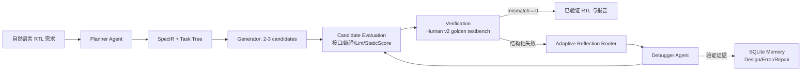
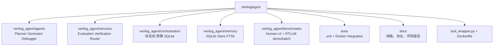
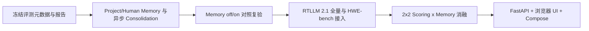

# VerilogAgent 当前工作总结与后续计划

> 更新日期：2026-09-08
>
> 软件版本：`0.2.4`
> 工作分支：`agent/human-v2-batch-eval`（对应远端同名分支；`main` 已合并至 PR #21）

## 1. 项目现在处于什么阶段

VerilogAgent 已从“Planner/Generator 原型”进入**可执行的 RTL 生成、验证和受控修复闭环**阶段：真实
Planner、Generator、Candidate Evaluation、golden-testbench Verification、Reflection Router 和
Debugger 都已接入同一 Orchestrator。当前还不是最终可交付产品：浏览器聊天界面、API、Docker Compose、
完整五类 Memory/异步 Consolidation，以及可归因的正式消融实验尚未完成。



边界不变：只有 Planner、Generator、Debugger 是 LLM Agent；评分、验证、路由、预算、状态机和
Memory 写入判定均是可审计的确定性代码。`ref.sv` 和 golden testbench 只由 Verification 使用，
不进入 Planner、Generator、Debugger 或可检索 Memory。

## 2. 已完成

| 里程碑 | 状态 | 已有证据 |
|---|---|---|
| Phase 0：仓库治理与自动化基线 | 完成 | Git/GitHub 私有仓库、CI、Issue/PR 模板、`v0.0.1-prototype` |
| Phase 1：安全 EDA 沙箱与统一工具接口 | 完成 | Docker + Icarus/Verilator/Yosys；`tool_wrapper.py` 的 lint/compile/simulate/eval_quality/benchmark |
| Phase 2：领域模型、状态机、Fake 闭环 | 完成 | SQLite 事件/检查点、预算、取消、恢复和离线测试 |
| Phase 2：真实 Planner / Generator | 完成第一版 | 严格 `SpecIR`/Task Tree、2-3 候选、接口校验、哈希去重 |
| Phase 2：Candidate Evaluation | 完成第一版 | 接口门禁、Docker 编译/Lint、StaticScore、排序与候选回退 |
| Phase 2：Verification / Router / Debugger | 完成第一版 | golden testbench、结构化最小反馈、分类路由、child candidate、重评估、回滚和修复预算 |
| Phase 3：证据驱动 Memory | 三类已实现 | `DESIGN_PATTERN/ERROR_PATTERN/REPAIR_STRATEGY`、FTS5/BM25、同题隔离、置信度、负迁移 quarantine、离线 consolidation；Project/Human 两类未完成 |
| Human v2 工程评测 | 已有全量基线与定向复测 | 156 题预检、一次全量模型运行、9 题定向复测、单题复核；详情见下节 |
| RTLLM 2.1 工程评测 | 入口已实现 | 50 题适配器、单题可视化 Demo、逐题批量与断点恢复已实现；官方参考预检 47 PASS、3 项 Icarus/testbench 不兼容；已完成 1 题单测和 1 题批量烟雾测试，尚未跑完整模型评测 |

当前代码结构：



## 3. 已有评测证据与正确口径

| 记录 | 结果 | 能说明什么 / 不能说明什么 |
|---|---:|---|
| Human v2 官方参考预检 | 154/156 PASS；2 项 Icarus cast 不兼容 | 数据集和验证管线可用；两项是工具异常，不是 Agent RTL 失败 |
| 第一次顺序全量模型运行 | 145/154 = 94.16%（全部 156 题口径 92.95%） | 当前闭环的首个全量工程基线 |
| 仅对首轮 9 个失败题定向复测 | 7/9 = 77.78% | 不是第二次 156 题实验 |
| 将定向复测回填首轮 | 152/154 = 98.70%（156 题口径 97.44%） | 修改后系统的有效合并结果，不能归因给单一模块或 Memory |
| `Prob078_dualedge` 后续单题复核 | 新生成 `cand_02` 通过；若作为补充回填为 153/154 = 99.35% | 新候选匹配了 golden 的 delta-cycle 调度；不是稳定复现，也不是 Debugger/Memory 的效果 |

定向复测在 `read_write` 下记录了 13 条 `RepairAttempt`；5 条验证成功的修复形成
`REPAIR_STRATEGY` Memory，其中 4 条因负迁移被 `QUARANTINED`，1 条仍为 `ACTIVE`。这证明
Memory MVP 的写入、检索、反馈和隔离链路可运行；**不证明** Memory 导致通过率提升，因为候选数、
修复提示、接口处理和模型调用也同时变化，且没有固定随机种子。

2026-09-08 对加入 Prob104 新闭环后的 172 个现存任务摘要执行确定性离线 consolidation，形成 153 条
去重后的 verified design pattern、13 类 error pattern 和 8 条 repair strategy（其中 4 条 ACTIVE）；完整门控和边界见
[`MEMORY_IMPLEMENTATION_ZH.md`](../../docs/reference/MEMORY_IMPLEMENTATION_ZH.md)。

完整证据和失败原因在
[`HUMAN_V2_TWO_RUN_EVALUATION_REPORT_ZH.md`](HUMAN_V2_TWO_RUN_EVALUATION_REPORT_ZH.md)。

## 4. 当前验证状态

验证记录必须分为“已验证的 Docker 回归”与“当前终端复验”，不能把其中任一项代替另一项。

### 4.1 已验证 Docker EDA 回归（12 条）

此前在可发现 Docker CLI 且可启动本地 EDA 镜像的受控环境中，以下 12 项**历史版本**集成测试均通过；
该结果在 `8f7a0ba` 的项目状态基线中记录为 `12 passed`。测试夹具随后改为 Human v2 来源的正例和
拒绝样例，因此下表是可追溯的历史 PASS 记录，不是当前终端对新夹具版本的执行结果。

| # | 集成测试 | 已验证行为 | 历史结果 |
|---:|---|---|---|
| 1 | `test_valid_counter_compiles` | 合法 counter RTL 可由 Icarus 编译 | PASS |
| 2 | `test_invalid_counter_reports_line_seven` | 非法 counter RTL 被结构化拒绝 | PASS |
| 3 | `test_valid_counter_passes_lint` | 合法 counter RTL 通过 Verilator lint | PASS |
| 4 | `test_counter_testbench_simulates` | counter RTL 与 testbench 可完成仿真 | PASS |
| 5 | `test_wrapper_does_not_write_build_products_to_repository` | 仿真产物不污染仓库工作区 | PASS |
| 6 | `test_sandbox_runs_non_root_with_complete_toolchain` | 沙箱以非 root 身份运行且工具链完整 | PASS |
| 7 | `test_input_outside_allowed_root_is_rejected` | 超出允许根目录的输入被拒绝 | PASS |
| 8 | `test_infinite_simulation_times_out` | 无限仿真触发超时保护 | PASS |
| 9 | `test_zero_exit_fail_text_is_not_treated_as_pass` | 返回码为零但含 FAIL 文本时仍判失败 | PASS |
| 10 | `test_zero_exit_nonzero_mismatch_count_is_not_treated_as_pass` | 返回码为零但 mismatch 非零时仍判失败 | PASS |
| 11 | `test_quality_evaluation_returns_deterministic_metrics` | 静态质量评估返回确定性指标 | PASS |
| 12 | `test_yosys_benchmark_returns_structural_metrics` | Yosys 返回结构统计指标 | PASS |

### 4.2 当前工作区复验（2026-09-08）

本次快速测试结果为：

```text
.\.venv\Scripts\python.exe -m pytest -q
122 passed, 13 skipped
```

13 项 Docker integration 默认跳过，其中新增 1 项是 Prob104 首样本初始化修复回归。Docker CLI 未加入
PATH，但通过 Docker Desktop 的绝对路径重建 `verilog-agent-sandbox:latest` 后，已显式执行：

```text
.\.venv\Scripts\python.exe -m pytest -q --run-integration -m integration
13 passed, 113 deselected in 10.45s
```

因此，当前 13 项 Docker/EDA 集成回归已复验通过。Docker 回归结果不计入 Human v2 的模型通过率。

在 Docker Desktop 已启动的本机 PowerShell 中，先执行 `Get-Command docker`。若能得到 `Source`，再运行：

```powershell
$env:DOCKER_BIN = (Get-Command docker).Source
.\.venv\Scripts\python.exe -m pytest -q --run-integration -m integration
```

若 `Get-Command docker` 没有输出，也可把 `DOCKER_BIN` 指向 Docker Desktop 的 `docker.exe`；
第 4.1 节的历史 PASS 仍保留原始夹具和原始测试名称。

## 5. 正在进行但尚未完成

1. **Memory 从三类证据库走向完整五类。** 当前缺少 Project/Human Intervention 专用 schema、异步
   Consolidation Worker、语义聚类和独立 A/B 证明；“事件与检查点”也不能替代长期 Memory。
2. **评测协议冻结。** 需要记录 prompt 版本/hash、temperature/top-p、token、API 成本、墙钟时间、
   Docker image digest、Icarus 版本、seed/采样参数，再完整顺序运行一次 156 题。
3. **Memory 增益复验。** Prob104 已完成独立 Icarus 回归和官方 golden 单题闭环；仍需在冻结模型、
   prompt、seed 和预算后做 Memory off/on 对照，才能量化 Memory 的净贡献。
4. **产品化。** FastAPI/SSE、浏览器聊天页、候选/诊断可视化、下载和 Docker Compose 都未开始。

## 6. 推荐的下一顺序



这样做先保证“通过率、失败原因和 Memory 声明”可审计，再把稳定闭环包装成任何人都能一键启动的产品。
